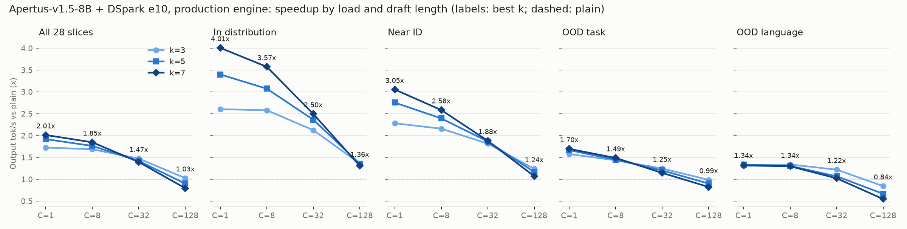

# DSpark e10 in production: headline speedups at k = 3, 5, 7

Status 2026-11-22: complete. Job 4004240 (nid006764, 2 h 31 min, one node,
d_research_serving): 16 deployments, 4 blocks × (plain, k3, k5, k7), 336 paired cells
(112 per k), none missing or rejected, runtime re-hash passed. Branch
`experiment/dspark-e10-k-headline`. Report: `results/8b/k-headline/report-20261122/`.

## Verdict

- **Headline (all 28 slices, equal weight; best k per load):** 2.01x at C=1 (k=7),
  1.85x at C=8 (k=7), 1.47x at C=32 (k=3), 1.03x at C=128 (k=3).
- **In distribution (math, code, multi-turn, held-out OPB):** 4.01x at C=1 (k=7),
  3.57x at C=8 (k=7), 2.50x at C=32 (k=7), 1.36x at C=128 (k=3 and k=5 tie).
- **Keep k=3 as the single deployed setting.** k=7 wins at C≤8 by up to 54% on ID
  traffic. But it loses at C=32 on the all-slice mean (1.39x vs 1.47x) and at C=128
  (0.79x vs 1.03x), where OOD-language traffic drops to 0.55x. That fails the frozen rule.
  The gap argues for choosing k by load (k=7 when lightly loaded, k=3 under load), not
  for a static change.
- **Sanity:** the k=3 arm reproduces the 2026-11-05 controlled k=3 class speedups within 2%
  on the same corpus (sha256 `7d8e60ef…`), e.g. ID 2.60/2.58/2.12/1.36x vs
  2.61/2.57/2.15/1.38x.

Action item B from the 2026-11-20 sync (transcript 45:38–46:00): the production
deployment was only measured at its deployed draft length k=3; the leads slide
deck and the Hugging Face release need its speedup at k=3, 5 and 7.

## What is measured

**Production** = Apertus-v1.5-8B with the DSpark e10 head (thinking off) as served
on the CSCS serving platform: TP1 bf16, max-model-len 32768, gpu-memory 0.8,
max-num-batched-tokens 16384, max-num-seqs 256, prefix caching off, the forced
thinking-off chat template, the `vllm_apertus_1.5_release` image (sha256
`f5fc017f…`) with the four DSpark source overlays. Only the draft length changes
between the DSpark arms. The live pod was not touched: the k=3 campaign showed
live and controlled speedups within ±7% (`docs/dspark-e10-task-speed.md`), so
controlled same-GPU runs stand in for it.

**Design.** `experiments/task-speed/submit-controlled.sh` with `TASK_SPEED_KS=3,5,7`:
- one node, 4 GPUs; each GPU runs a block of four fresh deployments, plain, k3, k5, k7,
  one after the other; the order is rotated by GPU (Latin square), so each arm runs in
  each position once;
- the 28-slice task-speed suite unchanged (`experiments/task-speed/suite.yaml`):
  ID, near-ID, OOD task and OOD language classes, 32 prompts per slice, greedy,
  natural EOS at each source's output cap, C = 1/8/32/128 with whole passes;
- speedup = DSpark output tok/s ÷ plain output tok/s of the same block, paired and
  validated exactly as in the k=3 campaign; groups are geometric means over their
  slices, with the exact bootstrap over the 4 blocks.

**Decision rule (frozen before results).**
- Headline per load: the k with the highest all-slices geomean speedup; called a
  tie when the runner-up is within 3%.
- Recommend changing the deployed k from 3 only if another k is ≥5% faster on the
  all-slices geomean at C=1, 8 and 32, with its interval clear of k3's, and not
  more than 5% slower at C=128.
- Sanity: the k3 arm must reproduce the 2026-11-05 controlled k3 class speedups
  within ±7%, or the run is not used.

## Restoring the production stack after the scratch purge

The November scratch purge had emptied the pilot directory that the harness
loads (`dev-dspark-12h-20261029-a`), the earlier cluster checkout and the
coverage prompt file. Restored without changing any byte that is measured:
- `experiments/k-headline/restore-pilot.py` rebuilds the pilot from the pilot
  records committed with the k=3 controlled run and the vLLM overlays and chat
  template of the live Deployment's ConfigMap
  (`breithorn-poc/rob-poc@20b21600:swissai-research-platform/models/vllm-apertus-dspark-e10/configmap.yaml`).
  All 4 overlays and the template match the pilot's recorded sha256;
  `environment.toml` differs only in the pilot path and the compile-cache path.
- `coverage.jsonl` was rebuilt with `apertus_bench.coverage_workloads`
  (`origin/workload-coverage` ba1533b0) from the pinned Hugging Face revisions
  in its manifest (job 4004231); it is byte-identical to the frozen file
  (sha256 `ddb921fe…`). The other four sources are the unchanged home-directory
  files, hash-checked by the submitter.
- The cluster checkout is a shallow sparse clone of the pushed branch at
  `/iopsstor/scratch/cscs/faruk_zahiragic/k-headline/code`.

## Results

Speedup = DSpark output tok/s ÷ plain output tok/s on the same GPU and prompts,
geomean over a group's slices. 95% intervals are the bootstrap over the 4 blocks:
they show run-to-run spread, not prompt sampling. Bold = best k for that load.



### Slide table

| Traffic | C=1 | C=8 | C=32 | C=128 |
|---|---|---|---|---|
| All 28 slices, best k | **2.01x** (k7) | **1.85x** (k7) | **1.47x** (k3) | **1.03x** (k3) |
| All 28 slices, deployed k3 | 1.73x | 1.69x | 1.47x | 1.03x |
| In distribution, best k | **4.01x** (k7) | **3.57x** (k7) | **2.50x** (k7) | **1.36x** (k3/k5) |
| Near ID, best k | 3.05x (k7) | 2.58x (k7) | 1.88x (k7≈k5≈k3) | 1.24x (k3) |
| OOD task, best k | 1.70x (k7≈k5) | 1.49x (k7≈) | 1.25x (k3) | 0.99x (k3) |
| OOD language, best k | 1.34x (k≈) | 1.34x (k3≈) | 1.22x (k3) | 0.84x (k3) |

≈: runner-up within 3%.

### Speedup by group, k and C

| Group | k | C=1 | C=8 | C=32 | C=128 | Acc. length |
|---|---|---|---|---|---|---|
| all | 3 | 1.73x [1.72, 1.74] | 1.69x [1.68, 1.69] | **1.47x** [1.45, 1.48] | **1.03x** [1.02, 1.03] | 2.45 |
| all | 5 | 1.92x [1.91, 1.93] | 1.76x [1.76, 1.78] | 1.42x [1.41, 1.43] | 0.90x [0.89, 0.91] | 2.92 |
| all | 7 | **2.01x** [2.00, 2.02] | **1.85x** [1.84, 1.86] | 1.39x [1.39, 1.40] | 0.79x [0.79, 0.80] | 3.23 |
| id | 3 | 2.60x | 2.58x | 2.12x | **1.36x** | 3.51 |
| id | 5 | 3.40x | 3.07x | 2.36x | 1.36x | 4.76 |
| id | 7 | **4.01x** | **3.57x** | **2.50x** | 1.31x | 5.78 |
| near-id | 3 | 2.28x | 2.16x | 1.82x | **1.24x** | 3.11 |
| near-id | 5 | 2.75x | 2.39x | 1.87x | 1.17x | 3.93 |
| near-id | 7 | **3.05x** | **2.58x** | **1.88x** | 1.07x | 4.50 |
| ood-task | 3 | 1.58x | 1.44x | **1.25x** | **0.99x** | 2.25 |
| ood-task | 5 | 1.67x | 1.45x | 1.20x | 0.90x | 2.48 |
| ood-task | 7 | **1.70x** | **1.49x** | 1.15x | 0.82x | 2.57 |
| ood-language | 3 | 1.31x | **1.34x** | **1.22x** | **0.84x** | 1.75 |
| ood-language | 5 | **1.34x** | 1.30x | 1.07x | 0.67x | 1.82 |
| ood-language | 7 | 1.32x | 1.30x | 1.02x | 0.55x | 1.82 |

Group intervals and per-slice cells are in the report.

### Latency (p50, geomean over all 28 slices)

| C | TTFT plain / k3 / k5 / k7 (ms) | TPOT plain / k3 / k5 / k7 (ms) | Output tok/s plain / k3 / k5 / k7 |
|---|---|---|---|
| 1 | 25 / 29 / 31 / 30 | 5.78 / 3.25 / 2.89 / 2.72 | 168 / 290 / 322 / 338 |
| 8 | 30 / 36 / 40 / 38 | 6.49 / 3.78 / 3.58 / 3.42 | 956 / 1,614 / 1,689 / 1,769 |
| 32 | 69 / 81 / 89 / 89 | 7.90 / 5.53 / 5.71 / 6.17 | 2,503 / 3,695 / 3,574 / 3,512 |
| 128 | 167 / 210 / 237 / 266 | 13.78 / 14.81 / 16.99 / 19.56 | 6,021 / 6,173 / 5,430 / 4,782 |

On in-distribution traffic, C=1 TPOT drops from 5.78 ms to 2.11 (k3) and 1.30 ms (k7).

### Why the best k moves with load

- Longer drafts pay off only where acceptance is high: ID acceptance length is
  3.5 / 4.8 / 5.8 tokens at k3/5/7. OOD-language acceptance barely moves
  (1.75 / 1.82 / 1.82), so k5/k7 add verification work there for nothing.
- At C≤8 the GPU has spare compute, and extra draft tokens are nearly free. At
  C=32–128 it is compute-bound, and rejected draft tokens displace other requests'
  work. The all-slice optimum moves from k7 to k3 between C=8 and C=32.
- TTFT rises with speculation (+4–6 ms at C=1; +43 to +99 ms at C=128 for k3 to k7)
  because draft and verify steps share the batch with prefills.

## Caveats

- These are controlled same-GPU numbers, not live gateway numbers. At k=3 the live
  deployment was within ±7% of controlled. There is no live check at k5/k7, because
  the pod was not touched.
- Slices weigh equally, so the "all" row is a suite average (5 ID, 6 near-ID, 5 OOD-task,
  12 OOD-language slices), not a forecast for the platform's actual traffic mix.
- Greedy decoding, thinking off, closed-loop load. Sampling (temperature 0.7) lowers
  acceptance and is not measured here.
- EAGLE e10 was not included (optional in the brief). Its exported head was on
  purged scratch, and the DSpark-vs-EAGLE comparison exists
  (`docs/system-optimizations-8b.md`).

## Reproduce

On a Clariden login node, from the scratch checkout of this branch:
```
python3 experiments/k-headline/restore-pilot.py --records results/8b/task-speed/controlled-20261104T133618Z \
  --configmap <live configmap.yaml> --configmap-source <repo@sha:path> --output <pilot>
TASK_SPEED_KS=3,5,7 TASK_SPEED_ACCOUNT=d_research_serving TASK_SPEED_TIME=07:00:00 \
  TASK_SPEED_PILOT=<pilot> experiments/task-speed/submit-controlled.sh
PYTHONPATH=src python3 experiments/k-headline/report-k-headline.py --run <run> --output <report>
python3 experiments/k-headline/plot-k-headline.py <report>
```

Provenance per run:
- `results/8b/k-headline/controlled-20261122T172956Z/`:
  - `provenance.json`: revision 288126c4, job, node, GPUs;
  - `spec.json`, `suite.yaml`, `environment.toml`, `preflight.json`, `profile.json`
    and `launch-manifest.json`: image, target, drafter and overlay hashes;
  - `runtime-recheck.json`, `artifact-manifest.json`, `corpus-manifest.json`;
  - `pilot-restore-report.json` and `coverage-rebuild-*`;
  - per cell, `metadata.json` and `summary.json`.
- Raw tree (`requests.jsonl`, Prometheus snapshots, time series, engine logs) as
  `/capstor/store/cscs/swissai/infra01/speculative-decoding/results-archive/k-headline/controlled-20261122T172956Z-raw.tar.gz`
  (sha256 in `results/8b/k-headline/controlled-20261122T172956Z-raw.tar.gz.sha256`).
- The prompt corpus holds restricted text and stays on the cluster; its hash is recorded.

Compute: 10.1 GPU-hours for the measurement (1 node × 2.5 h; 4 GPUs), plus about 2 CPU-minutes
for the coverage rebuild and the archive job. No failed attempts.
