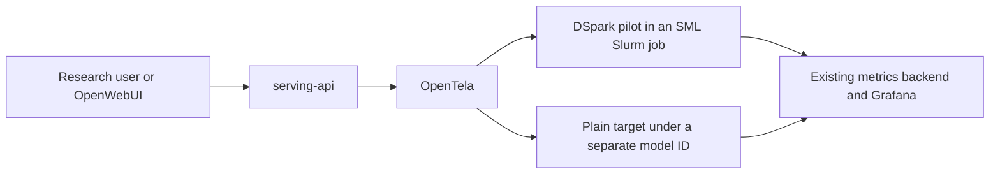

# DSpark 8B research serving execution plan

Deploy the existing Apertus 1.5 8B DSpark head from the completed 10 epoch run
as a small pilot on the research serving platform. Reuse `model-launch` for
the GPU deployment, OpenTela for discovery and routing, `serving-api` for the
authenticated API and UI, and the existing Prometheus and Grafana stack for
metrics. Start with fixed draft length **k=3**, thinking off, and a verified
plain-serving fallback.

Implementation: [operator runbook](../experiments/serving-pilot/README.md),
[pilot launcher](../serving/research-pilot.sh),
[launch audit](../results/8b/serving-pilot/launch-audit-20261028T151519Z/README.md),
and [continuation audit](../results/8b/serving-pilot/continuation-audit-20261028T154130Z/README.md).
The task branch is `feat/dspark-research-serving-pilot`.

This implements the first pilot in [P1 item 5 of the action items canvas](https://swissai-initiative.slack.com/docs/T0627JS49GT/F0C6431UBTP).
Faruk owns the deployment and validation; Rob supports platform integration
and capacity. Budget **1–2 working days**, excluding queue delays. The initial
pilot uses DSpark; EAGLE can follow through the same integration after this
path works. Training, the broader benchmark campaign in item 6, dynamic draft
scheduling, weight swapping and CPU offloading are outside this pilot.

## Existing components and deployment choice



SML already registers inference workers with OpenTela, which makes Slurm
workers reachable through the research platform. A Kubernetes deployment is
an option for subsequent persistent hosting. The first pilot can use a
bounded SML allocation and a published availability window.

| Component | Reuse and required integration |
| --- | --- |
| DSpark engine | [methods/dspark/launch/dspark.sh](../methods/dspark/launch/dspark.sh), including its checkpoint check and four compatibility patches |
| Target settings and plain serving | [serving/stage-defaults.sh](../serving/stage-defaults.sh), [serving/baseline.sh](../serving/baseline.sh) and [targets/8b/lock.json](../targets/8b/lock.json) |
| Environment and patches | [serving/resolve-env.sh](../serving/resolve-env.sh) and [serving/patch-vllm.sh](../serving/patch-vllm.sh), with an immutable overlay directory for each deployment |
| Platform access | Existing [serving-api](https://github.com/swiss-ai/serving-api) model discovery, OpenAI-compatible API, authentication and UI |
| Deployment and metrics | Existing [model-launch architecture](https://github.com/swiss-ai/model-launch/blob/main/docs/architecture.md), replica health checks, vmagent and DCGM |
| Validation | Existing `apertus_bench` client, correctness controls and [counter parser](../src/apertus_bench/prometheus.py); existing model-launch/k6 workflow for a small arrival-rate check |

Use a distinct model ID such as
`<username>/swiss-ai/Apertus-v1.5-8B-dspark-e10-k3`.
The current serving-api listing requires exactly three nonempty path segments
and OpenTela `sai-v0.0.6` or newer for user launches. The existing DSpark
launcher's default ID has two segments, so explicitly set `SERVED_MODEL`.
Use the exact same full ID in the engine, mesh registration, API request and
UI. `SwissAI-Research/` is reserved for platform-managed deployments; Rob
can use it if the pilot later becomes a managed service.

Keep plain and DSpark under separate IDs. OpenTela distributes requests
among peers with the same ID; registering both variants under one ID would
mix them instead of providing a controlled fallback.

## Checkpoint and initial configuration

The final checkpoint was present and readable on Clariden on 28 October 2026:

```text
/capstor/store/cscs/swissai/infra01/speculative-decoding/DSpark_Apertus_1.5_8B/dspark_apertus15-8b_open-perfectblend_thinking-off_2026-10-04_epoch10_final
```

It contains `model.safetensors` (about 3.2 GiB), `config.json`, `config.py`,
`run.yaml`, `train_command.txt`, `speculators.patch`, `training_state.json`
and `val_metrics.json`. Its verifier reference is target revision
`a411d838600baf0e3635a3daf66fb7c55fc97bb6`, matching the repository's target
lock. Its configuration has block size 8, an anchor slot, five target feature
layers `[1, 8, 15, 22, 29]`, a confidence head and native 2,048-token drafter KV.
Use this final artifact without retraining or modifying its weights.

| Setting | Initial pilot value |
| --- | --- |
| Target | `swiss-ai/Apertus-v1.5-8B`, pinned to the compatible revision above |
| Hardware | One GH200 serving GPU; target and head on the same GPU, TP=1 |
| Runtime | Existing `vllm_apertus_1.5_release-arm64.sqsh`, with the DSpark launcher's compatibility patches; verify digest and runtime revision before use |
| Speculation | `method=dspark`, `num_speculative_tokens=3`; retain standard target verification and rejection sampling |
| Precision | bf16, with actual engine and KV dtypes recorded |
| Context | 32,768 tokens; document this pilot limit in the model description |
| Engine | GPU memory utilization 0.8, batched-token limit 16,384, sequence limit 256, prefix caching off |
| Request behavior | Thinking off through the target chat template; validate both greedy and ordinary sampled requests |
| Sampling validation | Greedy plus temperature 0.7 / top-p 0.8; keep sampling top-k separate from draft length k |

The [existing measurements](system-optimizations-8b.md) support k=3 for mixed
traffic. k=7 improves low-load latency on suitable prompts but can regress
under load. Start validation at concurrency 1, 8 and 32; define the supported
pilot arrival rate from the measured results. Do not advertise a general
speedup for every workload. A separately named k=7 service can follow if
there is a concrete low-load use case.

## Execution sequence

### 1. Freeze the deployment inputs

**Faruk, about 1–2 hours; Rob confirms capacity and platform environment.**

Create a small declarative profile at
`experiments/serving-pilot/dspark-e10.yaml` containing the target and head
identities, runtime, patch list, engine settings, model IDs, availability
window, fallback ID and validation workload manifests. Resolve paths rather
than relying on shell defaults.

The proven environment file is currently in
`/users/faruk_zahiragic/model-launch-apertus/src/swiss_ai_model_launch/assets/envs/vllm_apertus_1.5_release.toml`.
The ordinary `model-launch` checkout does not contain this release environment
file. Pin a launcher installation explicitly and preserve this environment;
do not change the runtime to the non-release image to work around a path error.
The historical cluster `model-launch-apertus` directory has no Git metadata,
so preserve source hashes or a source archive as well as the corresponding
known revision. Check the actual `sml` executable and generated entrypoint.

Verify checkpoint ACLs for the serving account and all paths from inside the
resolved container mounts. Hash the weights, target assets and image in a
Slurm preflight where needed; do not assume the historical image digest in
the target lock still describes a mutable image-store path. Copy the small
training provenance files into the pilot's reproducibility bundle. If the
head must move to platform storage, compare its full manifest before use.

**Exit condition:** one resolved profile identifies readable, compatible
artifacts and the exact runtime, launcher and patch content.

### 2. Add a thin pilot launcher and render it for review

**Faruk, about 2–3 hours.**

Add `serving/research-pilot.sh` as a small wrapper around the existing DSpark
and baseline launchers. It should apply the profile, set the namespaced
`SERVED_MODEL`, allocate a unique deployment directory, set an explicit
`MODEL_LAUNCH_ROOT`, `ENV_SOURCE` and `sml` executable, and collect provenance.
Keep GPU execution and mesh registration inside SML.

Set `VLLM_PATCH_DIR` to a unique shared-filesystem path per deployment.
`patch-vllm.sh` clears its output directory, so reusing the default directory
could alter files mounted by a running server. Preserve the actual overlay
files and resolved TOML after rendering. Start with only the four patches
already selected by the DSpark launcher; the scheduler and sparse-KV
experiments are unnecessary for this pilot.

Use `VALIDATE_ONLY=1` for configuration checks, then SML's
`--output-script <run>/rendered` to inspect the full job before submitting.
Verify supported CLI options against the pinned launcher. Check that the
resolved image, model names, patch mounts, metrics and development mesh are
correct, and that OpenTela registration is enabled.

Start on the development platform using `--dev` or the supported explicit
bootstrap override. Confirm the worker's actual OpenTela version; update
only the mesh binary or launch integration if needed for model discovery.

**Exit condition:** rendered scripts and launch metadata are reproducible,
use the expected engine entrypoint, and target the development platform.

### 3. Validate the engine and the complete platform request path

**Faruk, with Rob for discovery or routing issues, about 2–3 hours plus GPU time.**

Launch the pilot and a matched plain configuration for validation. Use the
same image, target, tokenizer, chat template and applicable target patches;
record effective scheduling differences required by the runtime. First
check the replica's `/health`, a successful completion and speculative
counters. Then validate through the authenticated development gateway and
UI, including `/v1/models` discovery and `/v1/chat/completions`. Confirm the
response's model ID matches the requested full ID.

Run a bounded behavior matrix:

| Behavior | Required check |
| --- | --- |
| Ordinary chat | Single turn and multi-turn, streaming and non-streaming, with valid final responses |
| Completion handling | Usage accounting, finish reasons, natural EOS, max-token termination and stream completion |
| Thinking setting | Thinking-off template rendering and expected visible output in both API and UI |
| Representative inputs | Existing chat, summarization and code/math prompts, plus a few multilingual examples |
| Request limits | A near-limit context, an over-limit rejection, cancellation and client disconnect |
| Optional advertised features | Tool-call parsing, structured outputs and logprobs only where the pinned stack passes the checks; document the supported feature set |

Apply the [repository correctness protocol](protocol.md#greedy-correctness-gate):
keep within-deployment repeats and independent same-configuration controls
for the cross-deployment plain-versus-DSpark comparison. Freeze the margins
in the pilot profile before judging results. Record exact matches and the
other divergence measures; exact equality alone is not the gate. Sampled
requests need valid behavior and unchanged target sampling semantics, not
identical fixed-seed strings.

For the performance check, reuse the 64-prompt probe and whole prompt passes
of existing chat and summarization workloads at C=1, 8 and 32. Warm up first,
compare matched plain and DSpark settings, and exclude unrelated traffic
from these cells. Measure both the direct engine and gateway path so the
effect of routing is visible. Repeat only questionable cells or close
comparisons. The broader workload and layout sweeps remain in item 6.

Run the benchmark client against the pilot directly. `serving/loadtest.sh`
owns and cancels its server on exit, so reserve that helper for disposable
validation deployments.

**Exit condition:** ordinary requests and the calibrated correctness gate
pass, speculative counters advance, and the initial supported load is known.

### 4. Expose performance and acceptance through existing metrics

**Faruk, with Rob for scrape and dashboard integration, about 1–2 hours.**

Use SML's existing vmagent/DCGM path and Grafana. Verify that the actual
deployment exports and ships the speculative counters; launch telemetry is
a separate one-time metadata record. Collect `/metrics` through the metrics
plane rather than assuming the inference gateway proxies it.

Add panels or queries for:

- Request rate, failures, TTFT, time per output token and p50/p95 latency.
- Output tokens/s, active and queued requests, KV use, preemptions and GPU memory.
- Draft rounds, proposed draft tokens, accepted draft tokens and acceptance by position.
- Deployment identity, checkpoint hash, draft length, runtime revision, uptime and expiry.

Reuse the harness definitions: acceptance is accepted draft tokens divided
by proposed draft tokens; mean acceptance length is
`1 + accepted draft tokens / draft rounds`, including the bonus-token
convention. Aggregate numerator and denominator before taking a ratio.
Missing counters mean unavailable acceptance, and restarts reset the
measurement window. Acceptance during shared pilot traffic is an aggregate
of that traffic, not a per-task attribution.

Run a short arrival-rate check with the existing model-launch/k6 tools at
the intended pilot rate, using identical prompts and offered rate for plain
and DSpark. Report dropped iterations and failures. Use streaming-capable
measurement for TTFT; a non-streaming request timer cannot establish it.
This is an operational check, not completion of item 6's scheduler study.

**Exit condition:** an operator can see whether speculation is active and
whether users benefit, and can identify overload, failure or an expiring job.

### 5. Verify fallback and open the bounded pilot

**Faruk and Rob, about 1–2 hours plus a 2–4 hour observation window.**

Identify a healthy plain Apertus 1.5 8B endpoint with the compatible target
revision and required API behavior. Verify it through the same gateway;
the presence of a deployment manifest does not establish that it is running.
If no suitable plain endpoint exists, launch one using `serving/baseline.sh`
and include its allocation in the budget.

Expose the DSpark and plain IDs explicitly in the runbook and model
description. Pilot fallback is a documented switch to the plain model ID.
Keep it available while DSpark is stopped or replaced. Automatic fallback
would require separately verified routing behavior; the present plan does
not assume it exists. A partially delivered stream must not be silently
replayed on another engine.

Test rollback on the development deployment: stop only the pilot-owned
DSpark job, verify its discovery/health behavior, and complete a request
against plain. Restart DSpark in a new deployment directory and recheck
registration. Before the research pilot opens, record the operator, expiry,
availability window and exact restart/stop commands. SML consecutive-job
support may extend uptime after its handover is verified, but queues can
still produce gaps. Rob can move the validated configuration into the
existing Kubernetes deployment workflow if continuous hosting is needed.

After the development gates pass, launch the same frozen profile on the
research platform's mesh in a new deployment directory. Repeat model
discovery, authenticated API, UI, metrics and plain-fallback smoke checks
through the research gateway before inviting users. Observe this deployment
for 2–4 hours at the documented load and retain the development evidence.

Proposed release gates, to freeze before validation:

- All required behavior and correctness checks pass, with no unexplained
  server errors, malformed streams or restart during measured cells.
- Both the API and UI discover and use the pilot; metrics and plain fallback work.
- At the intended load, DSpark shows a useful latency or throughput benefit
  on the selected traffic, without a repeated p95 latency regression above
  10% versus matched plain serving. Narrow the supported workload or load
  range if necessary instead of assuming every request benefits.
- The observation window has no engine crash, OOM or sustained growing queue.

Content recording remains gated by canvas item 4. Check the effective
request logging and Langfuse tracing settings before accepting pilot users;
keep live prompt/completion capture off while that gate is unresolved.
Aggregate operational metrics and approved fixed validation datasets can
be used independently. Retain full correctness outputs only for those
validation datasets.

## Artifacts and completion

Use a new directory such as
`results/8b/serving-pilot/<deployment-id>/` for every independent launch,
including failed and replacement deployments. Keep a small pilot index
linking DSpark, plain, controls and any restarts. Preserve:

- The resolved profile, launch argv, rendered scripts, resolved environment,
  source revisions or source archive, image digest, patches and overlay files.
- Target revision, tokenizer and template hashes, full head checksum manifest,
  checkpoint configuration and the associated DSpark training provenance.
- Slurm job/node IDs, readiness and validation reports, launch and engine logs,
  model IDs, startup memory breakdown, and allocated versus active GPU-hours.
- Each benchmark cell's `metadata.json`, `requests.jsonl`, `summary.json`,
  workload digest and raw metric snapshots; k6 scenario, raw results and status.
- Dashboard queries, supported request features, pilot limits, fallback and
  rollback commands, operator and availability window.

Pass relevant non-secret provenance with `--metadata KEY=VALUE`. The current
DSpark launcher reports the config hash and weight sizes; extend the pilot
wrapper to retain full weight hashes and run provenance. Do not treat the
existing printed report as a complete reproducibility bundle. If a
Speculators launch helper is used instead, always pass `--provenance-dir`
and preserve its command, checkpoint-hash and patch artifacts.

SML currently allocates an exclusive four-GPU node for a TP=1 launch.
One DSpark engine uses one GPU but is billed as four allocated GPUs; a
separate plain launch can require another node. Confirm the pilot budget
with Rob, reuse a verified existing plain service where possible, and
release validation allocations promptly. Report both allocated cost and
active serving GPUs.

The pilot is complete when researchers can select the DSpark service on
the existing platform, ordinary requests pass, acceptance and performance
are visible, plain fallback is tested, and another operator can recreate
or roll back the deployment from the saved artifacts. Record the endpoint,
supported behavior, evidence and limits in the existing Apertus 1.5 work
tracking. Completion of this DSpark pilot does not establish EAGLE support
or completion of the final 8B study.
