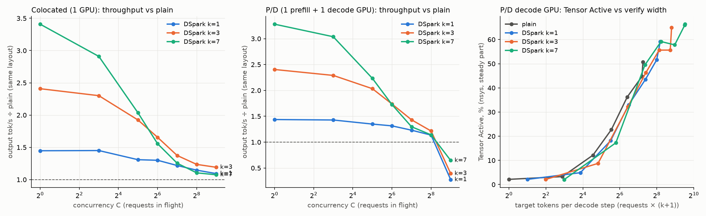

# When does a P/D decode instance become compute-bound under speculation?

Question (Yu, 2026-11-20 huddle): with prefill disaggregated, the decode GPU
only verifies drafts, so at what concurrency does speculative decoding stop
paying for itself because the decode GPU runs out of compute?

## Setup

One GH200 node, job 4004291 (branch `experiment/pd-decode-compute-bound`,
spec `experiments/pd-decode-compute-bound/sweep.yaml`). Apertus 1.5 8B,
DSpark e10 thinking-off at k = 1, 3, 7 and plain, each both colocated (1 GPU)
and P/D (1 prefill + 1 decode GPU, NIXL 1.5.0). Yu's held-out OPB prompts,
closed loop at C = 1..512 (≥64 requests, 4 per slot). Every server exports
vLLM's analytic FLOP/byte counters (`--enable-mfu-metrics`), and nsys
GPU-metrics sampling (no CUDA tracing) recorded SM/tensor/DRAM activity of
every GPU for the whole job (`SWEEP_GPU_METRICS=1`,
`apertus_bench.gpu_metrics`). EAGLE e10 was planned but its head on scratch
was purged. 63 cells, 0 failed requests; the repeat plain arm is within ±1%.

Raw record: `results/8b/sweeps/sweep-20261122T173715Z/` (tables and chart in
`report/`; `requests.jsonl` files and nsys reports stay on Clariden scratch,
hashed in `kept-on-scratch.sha256`). Smoke: `results/8b/sweeps/smoke-20261122T172706Z/`.

## Result



Throughput over plain of the same layout:

| C | colo k1 | colo k3 | colo k7 | P/D k1 | P/D k3 | P/D k7 |
|---:|---:|---:|---:|---:|---:|---:|
| 1 | 1.45 | 2.41 | 3.41 | 1.44 | 2.40 | 3.28 |
| 32 | 1.31 | 1.92 | 2.03 | 1.35 | 2.03 | 2.23 |
| 128 | 1.22 | 1.37 | 1.25 | 1.23 | 1.43 | 1.30 |
| 256 | 1.15 | 1.24 | 1.10 | 1.14 | 1.22 | 1.14 |
| 512 | 1.09 | 1.19 | 1.08 | **0.28** | **0.39** | **0.65** |

- **The decode GPU does become compute-bound, gradually, and speculation
  still wins up to C = 256.** On the P/D decode GPU, nsys Tensor Active
  rises from ~2% (C = 1) to 55–66% at 250–740 verified tokens per step, while
  DRAM read falls from ~65% to ~25%; vLLM's FLOP estimate goes from ~1% to
  ~30–38% of BF16 peak. The k = 7 advantage over k = 3 is gone by C = 64
  (both 1.73x), and every k shrinks to 1.14–1.22x at C = 256. The same
  pattern holds colocated, where prefill shares the GPU.
- **P/D speculation beats colocated speculation at moderate-to-high load**:
  at C = 256 P/D k3 serves 11.4k tok/s vs 9.6k colocated (two GPUs vs one, so
  not per-GPU efficiency); P/D plain also gains (9.4k vs 7.8k).
- **The P/D cliff at C = 512 is KV capacity, not compute.** The drafter's KV
  shrinks the decode pool from 470k to 343k tokens; at C = 512 it fills
  (100% usage, 62 s above 90%), with 7,628 preemptions, ~267 requests
  waiting and p50 TTFT of 23 s. Plain P/D at C = 512 has no preemptions.
  Colocated speculation fills the same 343k pool at C = 512 too, but with
  289 preemptions instead of 7,628 and keeps 1.19x. Why P/D preempts 25x more
  (likely: requests arrive from the prefill GPU with their prompt KV and a
  preempted one is recomputed on the decode GPU) is not verified. Interpolated
  crossovers (speedup = 1) are at C ≈ 286 (k1), 307 (k3), 312 (k7), but they
  are set by this cliff.
- The earlier P/D HTTP 500 / ReadError failures at high C did not recur with
  the servers' idle keep-alive raised to 300 s (`VLLM_HTTP_TIMEOUT_KEEP_ALIVE`).

## Caveats

One job, one node, one workload (OPB held-out, ~563 prompt / ~480 output
tokens); between-job spread on this harness is up to ~6%. vLLM's FLOP/byte
counters are analytic estimates; nsys "Tensor Active" is the fraction of
cycles the tensor pipes are busy, not FLOP efficiency. The C = 512 P/D result
depends on the decode instance's KV budget (gpu-memory-utilization 0.8); a
larger budget or an admission cap at the proxy would move the cliff.

## Reproduce

```
SWEEP_GPU_METRICS=1 NSYS=<nsys 2025.6.3> SWEEP_PARTITION=normal SWEEP_TIME=03:00:00 \
  serving/node-sweep.sh experiments/pd-decode-compute-bound/sweep.yaml
python3 experiments/pd-decode-compute-bound/report.py SWEEP_DIR OUT_DIR
```
