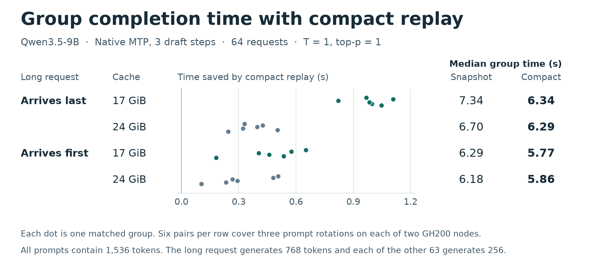

# Does compact state start a late request sooner?

The endpoint is wall-clock time until the last of 64 requests finishes on one Qwen3.5-9B engine. The designated long request arrives first in one condition and last in the other. For that request, measure its rank by server receipt time, scheduler queue time, time to enter its first forward pass, prefill completion and final completion. Also identify the actual last finisher and count retractions. Queue time is reported directly by the server. A nonstreaming client cannot establish when the first token reached the client.

## Measured results

Each of the two Clariden jobs ran one deployment per GPU on four GH200s. The allocations lasted 244 s and 232 s, for a total of 0.529 GPU-hours. Both jobs exited successfully. Across 48 groups, all 3,072 requests returned the required token count. The designated request was received first or last as intended in every group. The servers reported zero retractions across all arms. All values below are medians across six matched groups per condition (three prompt rotations on each node). The last column takes the snapshot-to-compact percentage change within each pair before computing its median.

| Cache budget | Long request arrives | Requests started before first completion, snapshot / compact | Long request scheduler wait, snapshot / compact | Group time, snapshot / compact | Paired group time saved |
|---|---|---:|---:|---:|---:|
| 17 GiB | Last | 25 / 63 | 4.80 / 3.98 s | 7.34 / 6.34 s | 13.4% |
| 17 GiB | First | 25 / 63 | <0.001 / <0.001 s | 6.29 / 5.77 s | 7.9% |
| 24 GiB | Last | 63 / 63 | 4.25 / 3.94 s | 6.70 / 6.29 s | 5.2% |
| 24 GiB | First | 63 / 63 | <0.001 / <0.001 s | 6.18 / 5.86 s | 4.6% |



At 17 GiB the snapshot pool held 45,186 KV tokens. Twenty-five background requests need 44,800 tokens at their full output caps. Twenty-six need 46,592. On the first node the snapshot scheduler logged 25 running and 39 waiting, consistent with that budget. At 17 GiB with the long request last, compact saved a paired median of 0.89 s in its scheduler queue and 0.99 s in group time. Paired group savings ranged from 10.4% to 15.2%. The two node medians were 13.5% and 13.3%. The designated request finished last in every long-last group at both budgets. Even at 24 GiB it waited nearly four seconds with compact state, and the measured overlap stopped at 63. One high-budget compact server logged 58 running requests, followed by a prefill of five sequences totaling 6,656 tokens, then 63 running and one queued at about 17% KV usage. A continuing 512-token chunk plus four full 1,536-token prompts accounts for that prefill. The pinned SGLang scheduler includes a continuing chunk in its prefill list and compares the list length with available request rows (`sglang/srt/managers/scheduler.py`, methods `get_num_allocatable_reqs` and `_get_new_batch_prefill_raw`). That guard is consistent with one request waiting despite spare KV. The logs omit the per-request rejection reason.

The larger memory budget and the long-first placement both reduce the observed advantage. For each prompt rotation, subtract the long-first time saving from the long-last saving and compare that difference at 17 versus 24 GiB. The extra group-time saving associated with memory pressure and arriving last was positive in all six pairs, with a median of 0.49 s (range 0.19–0.72 s). Rejection sampling uses a global RNG, so changes in batch execution can change acceptance on identical prompts and output lengths. The measured contrast includes that variation. [Per-request measurements and paired contrasts](../results/public-hybrid/queue-pressure-20261128)

Startup logs confirmed the planned KV capacities and accounted for target KV, MTP KV, recurrent matrices, convolution history and replay buffers within the rounding of the component logs. On the 17 GiB arms, reported target weights were 17.62 GiB and CUDA graph allocations were 3.06–3.09 GiB. Device-wide peak samples during the workload were 40.3–40.6 GiB for the low-budget GPUs and 47.6–47.7 GiB for the high-budget GPUs. [Allocation records and checksums](../results/public-hybrid/queue-pressure-20261128/SHA256SUMS)

## Workload and controls

- Each arm serves the same public Qwen3.5-9B checkpoint and native MTP head, BF16 weights and KV, FP32 recurrent matrices, TP1, fixed three speculative steps, rejection sampling at T=1 and top-p=1, FCFS scheduling, and a 64-request ceiling. Radix caching is off. One process owns each GH200.
- Sixty-four synthetic 1,536-token prompts use repeated text from the first eight pinned DAPO-Math-17k prompts. Each contains its own exercise ID. Sixty-three background requests generate 256 tokens apiece, and the designated long request generates 768. Each group therefore generates 16,896 tokens. A 75 ms gap separates the singleton and the other 63 dispatches. Validate the intended first/last rank at server receipt and keep both the scheduling cost and any deliberate delay visible. Each arm repeats both orders with three paired prompt rotations. The global rejection-sampling RNG can produce different continuations across arms.
- At each memory budget, compare native intermediate snapshots with compact GDN ReplaySSM. The four arms run on separate GPUs. A second allocation rotates the GPU assignments and repeats the inputs.
- SGLang reserves 65 recurrent slots including its sentinel. The snapshot window uses 12.1875 GiB of intermediate matrices. Compact uses about 0.574 GiB of records. Both arms also need persistent and convolution state. Each additional KV token costs 32 KiB for the target and 4 KiB for the MTP head. For each budget, give the arm all the KV slots that fit after its recurrent state, accounting for SGLang’s one extra KV slot. Validate the realized capacity and the actual startup allocation for both KV pools and recurrent state. These are budgets for recurrent state plus target and draft KV. Record graph, weight and device-wide memory separately. [Exact byte ledger](../experiments/public-queue-pressure/cache_budget.py)

| Recurrent and KV budget | Snapshot KV tokens | Compact KV tokens | Total input tokens offered |
|---|---:|---:|---:|
| 17 GiB | 45,186 | 383,446 | 98,304 |
| 24 GiB | 249,076 | 587,336 | 98,304 |

## Paired comparison

Within each deployment, budget, order and prompt rotation, subtract compact time from snapshot time for the designated request's scheduler wait and for the group's completion. Positive values mean compact saves time. Use the 24 GiB comparison to estimate what persists when both arms have room for the workload. The long-first groups test whether any benefit depends on admission order. Retain all repeat and deployment values. A saving in queue time can be offset by verification, prefill or decode time, or another request can become the last finisher.

The result establishes a fixed-depth comparison on one public GDN model under a synthetic long-context workload. The larger saving for a late long request at the tighter budget supports testing the memory mechanism under representative rollout traffic. A submission-wide claim still requires a matched deployment on the target workload, comparison with a tuned adaptive draft-depth baseline at equal memory, and a sampling-correctness check. This study measured group completion under rejection sampling, with timing dependent on the realized batch schedule.

## Reproduce the analysis

The public measurement archives contain one row for each of the 3,072 requests, including client and scheduler timestamps, server receipt order, token counts, sampling seeds, speculative counters and output-vector hashes. They also contain per-cell metadata and summaries, before/after Prometheus samples with portable model and process labels, memory samples by GPU index, resolved launch commands, the measured configuration, and allocator and scheduler lines from the server logs. Dataset and model revisions, image and tokenizer hashes, node assignments and job durations accompany the measurements. Original prompt and output token vectors are represented by counts and SHA-256 digests. The exporter checks the complete vectors in each original before computing the public records. [Model and workload](../results/public-hybrid/queue-pressure-20261128/model-and-workload.json) · [Source and original archive digests](../results/public-hybrid/queue-pressure-20261128/provenance.json)

From the repository root, run the following with Python 3.12. Both comparisons should exit successfully. The plotting command requires Matplotlib, version 3.11.1 for the archived rendering.

```bash
set -eu
results=results/public-hybrid/queue-pressure-20261128
(cd "$results" && sha256sum -c SHA256SUMS)
replay_dir=$(mktemp -d)
for job in 4060288 4060290; do
    tar -xzf "$results/records-$job.tar.gz" -C "$replay_dir"
    python3 experiments/public-queue-pressure/summarize.py --public-records "$replay_dir/run-$job" > "$replay_dir/job-$job.json"
    cmp "$results/job-$job.json" "$replay_dir/job-$job.json"
done
python3 experiments/public-queue-pressure/plot.py "$results" "$replay_dir/group-time.png"
```

The original tarballs and SHA256SUMS are retained in the CSCS Clariden project store under `results-archive/qwen35-queue-pressure-20261128`. They include complete prompts, output IDs, original Prometheus snapshots, deployment configuration, scheduler logs, device inventory and Slurm metadata. Each public archive contains the original run-file digests. With access to an original, the following command rebuilds its public archive and verifies that both representations generate the published job summary byte for byte.

```bash
python3 experiments/public-queue-pressure/export_records.py /path/to/original/job-4060288.tar.gz "$replay_dir/records-4060288.tar.gz"
cmp "$results/records-4060288.tar.gz" "$replay_dir/records-4060288.tar.gz"
```

## Repeat the serving experiment

The two jobs executed source commit `978eb0193b4eff7a5158294e2ebc892ae1447ceb` on `experiment/public-hybrid-queue-pressure`. All node-side scripts on this archive branch match the executed file digests. The submission wrapper resolves the remote username for its scratch directory and accepts the archive branch name. The launch requires a configured Clariden SSH alias, Slurm allocation access, and the container and model files recorded in the runtime manifest. The pinned container reports SGLang 0.5.20 and includes the ReplaySSM engine. Validate its digest before running on another installation.

From a checkout of the archive branch, recreate the eight public input examples. Download the pinned parquet, install PyArrow, and run the extractor. It checks both the parquet digest and the rendered prompt digest. The dataset card identifies its license as Apache-2.0. [Pinned DAPO dataset card](https://huggingface.co/datasets/BytedTsinghua-SIA/DAPO-Math-17k/blob/65877096c24ffa7abc4e4fa5edb95cf3413a5674/README.md)

```bash
curl -fL -o "$replay_dir/dapo-math-17k.parquet" https://huggingface.co/datasets/BytedTsinghua-SIA/DAPO-Math-17k/resolve/65877096c24ffa7abc4e4fa5edb95cf3413a5674/data/dapo-math-17k.parquet
python3 experiments/public-hybrid-recovery/prompts.py "$replay_dir/dapo-math-17k.parquet" "$replay_dir/prompts.json"
bash experiments/public-hybrid-recovery/submit.sh "$replay_dir/prompts.json"
GDN_ROTATE=1 bash experiments/public-hybrid-recovery/submit.sh "$replay_dir/prompts.json"
```
