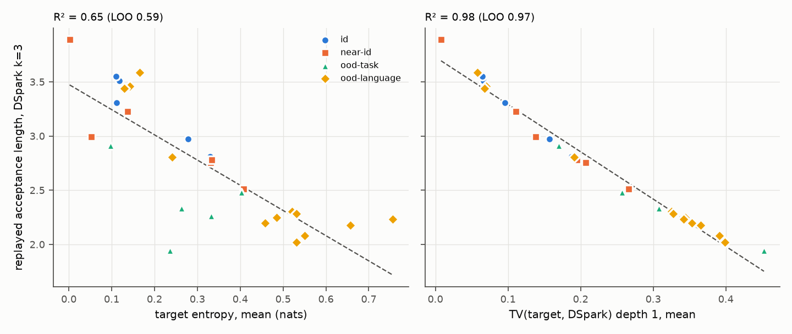
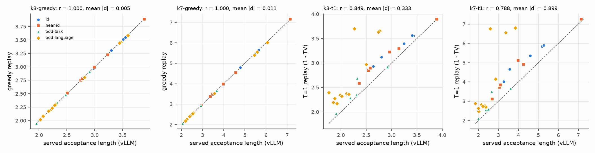
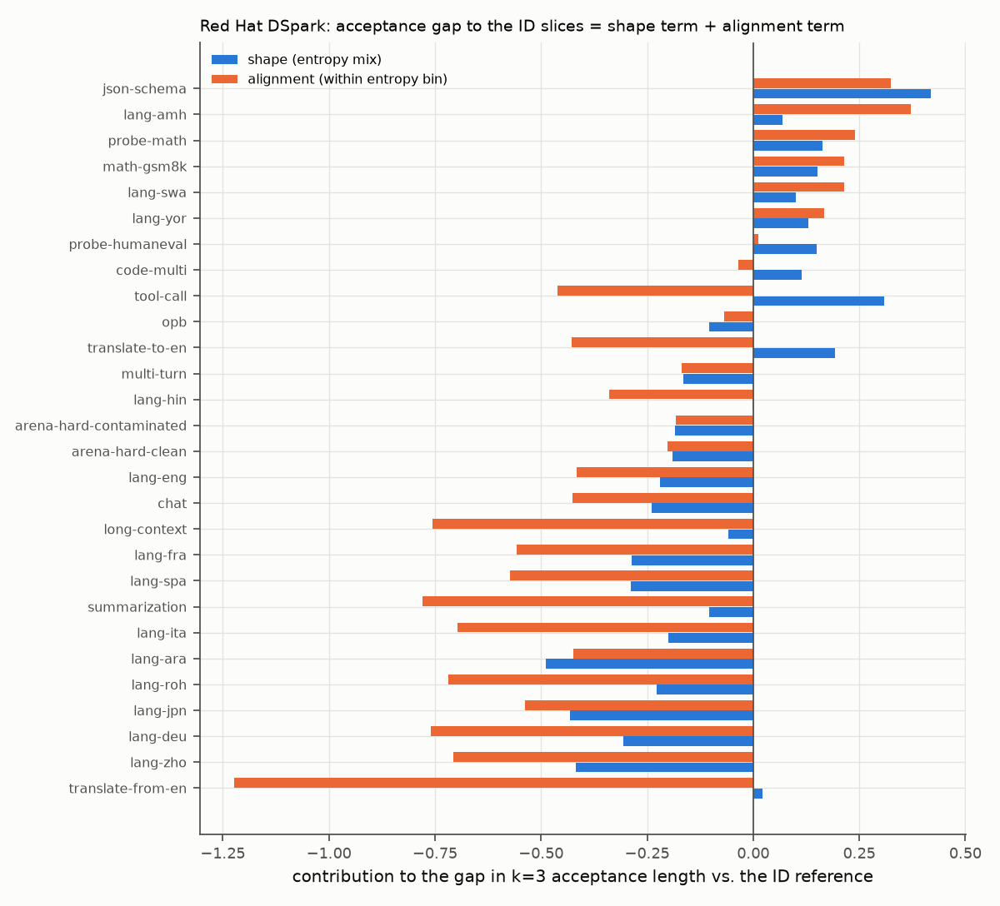
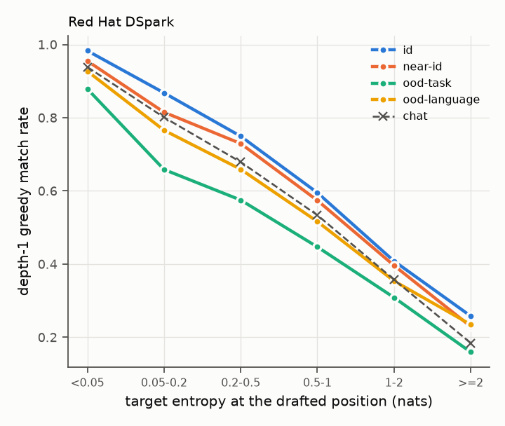
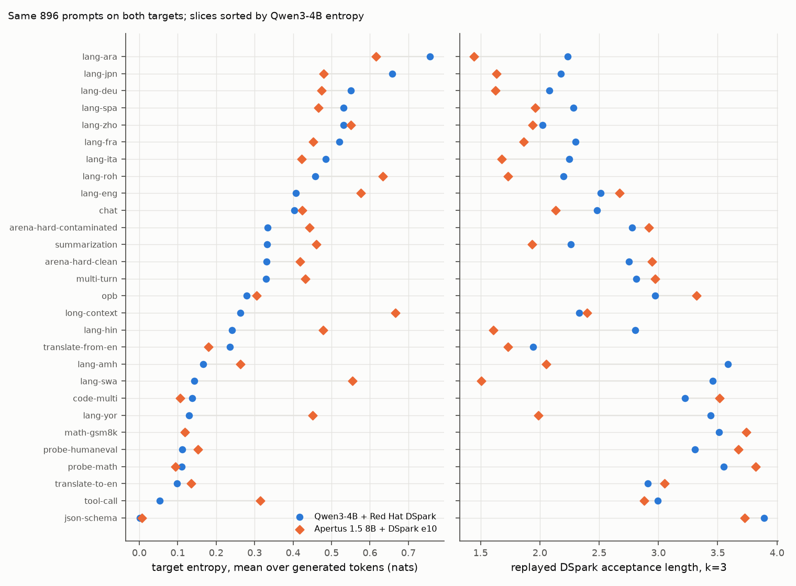

# Workload distribution shape on Qwen3-4B (Red Hat DSpark drafter)

Repeat of the Apertus 1.5 8B study ([`workload-distribution-shape.md`](workload-distribution-shape.md),
job 4004306) on a second target, as Yu suggested on 2026-11-22: acceptance depends
on (1) target entropy, (2) target-drafter alignment and (3) greedy vs sampled
drafting, and Qwen3-4B "shows a clearer trend of the entropy". The question is
whether the Apertus verdict (alignment, not entropy, explains the chat and
non-English gaps) holds on a target and a drafter we did not train.

Pre-registered in commit `d8abec6f` (pushed before any measurement). The
"Setup" and "Pre-registered decision rule" sections are unchanged from that commit.

## Summary

**Verdict: mixed.** Neither pre-registered criterion is met on Qwen3-4B. TV
explains acceptance far better than entropy, as on Apertus, but chat's gap is
smaller and only 64% of it is alignment (the bar was 70%). Entropy explains more
than on Apertus but stays well short of its bar. The Apertus run, scored with the
same rule, is "alignment generalises".

- **Gate passed.** Offline greedy replay matches vLLM 0.30.0 serving the same head
  on the same 896 prompts. At k=3: Pearson r = 0.99995, mean absolute difference
  0.005 tokens per step (worst slice 0.015). At k=7: r = 0.99995, mean
  difference 0.011 (worst 0.042). The head code also matches speculators'
  `DSparkDraftModel` on the real checkpoint (max |Δ log-prob| 3.6e-5, argmax
  agreement 1.0, 2,600 tokens across the 2,048-token window).
- **Entropy explains more than on Apertus, TV still nearly all.** Across the 28
  slices, mean target entropy explains R² = 0.65 of k=3 acceptance (LOO 0.59;
  Apertus 0.52). Mean depth-1 TV explains 0.98 (LOO 0.97), and both together
  0.98. Over the 896 sequences: entropy 0.59, TV 0.95.
- **Chat and the languages: a third shape, two thirds alignment.** Relative to
  the ID slices (3.15 tokens per step), chat is 0.67 tokens short. The entropy-mix
  (shape) term is 0.24 of that (36%) and alignment 0.43 (64%). The 12 non-English
  slices pooled are 0.70 short: shape 0.24 (34%), alignment 0.46 (66%). Only
  lang-ara has a shape share of at least 50% (0.54). On Apertus the same split was
  14% / 86% for chat and 14% / 86% for the languages.
- **The trend is somewhat clearer on Qwen, not dramatically.** The between-slice
  SD of mean target entropy is 0.20 nats on Qwen against 0.18 on Apertus (range
  0.75 vs 0.66). The slice-level correlation of entropy with acceptance is -0.81
  against -0.72. What changed more is the drafter. Red Hat's head is better aligned
  on chat (depth-1 TV 0.26 vs 0.35; match at near-certain tokens 0.94 vs 0.77)
  and on the European languages. That shrinks the alignment term and raises the
  shape term's share.
- **Confounder: degenerate target output.** Qwen3-4B loops on low-resource
  languages: 27/32 Swahili, 31/32 Amharic and 10/32 Yoruba continuations have more
  than half of their 4-grams repeated (Apertus: 3, 14 and 1). Their near-zero
  entropy and high acceptance (3.4-3.6) are the target repeating itself, not
  confident fluent text. Dropping them (post hoc, not pre-registered) changes
  nothing: entropy R² 0.63, TV 0.97, still mixed.
- **Sampled drafting (Yu's third factor).** On the greedy trajectories, the T=1
  replay (per-depth acceptance 1 - TV, chained) gives the same picture as greedy:
  entropy R² 0.62, TV 0.98. Served at T=1, acceptance is lower than greedy on
  26 of 28 slices at k=3 (chat by 0.16); json-schema and translate-to-en are equal. Against the served T=1 counters, entropy
  explains 0.70 and greedy-trajectory TV 0.77 (both 0.82). Sampling narrows the
  difference, but the TV here was measured on greedy paths. The replay overestimates
  the served T=1 numbers by 0.25 tokens per step on the non-looping slices
  (r = 0.97) and by up to 1.4 on the looping ones, most likely because sampling
  breaks the loops and visits less predictable states than the greedy path.

**What it means.** The Apertus conclusion, that the drafter's coverage of the
target's behaviour rather than the target's flatness drives the workload gaps,
holds in direction on a second target and a drafter we did not train: TV
dominates and most of each gap is within-bin. The size of the shape term is not
universal, though. It rises from about 0.2 to about 0.24 tokens on a smaller
absolute gap, so with a better-aligned drafter, flat distributions become a third
of what is left. Judging ID vs OOD by depth-1 TV on a small teacher-forced sample
still works. Language slices need an output-degeneracy check first, or they look
"in distribution" for the wrong reason.

## Results

The two left panels are the pre-registered gate (greedy). The two right panels compare the T=1
replay on greedy trajectories with served T=1 acceptance. That check is
not a gate; it shows where the 1 - TV replay stops being a good proxy.

The same 896 prompts on both targets. The per-slice entropy of the two targets
correlates at r = 0.68 and the acceptance at r = 0.65. The large moves are the
looping languages (swa, yor, amh; lower entropy on Qwen) and long-context and
tool-call (lower entropy on Qwen).

Other figures: [`shape-map-dspark.png`](../results/qwen3-4b/workload-shape/full-20261127-4052179/figures/shape-map-dspark.png),
[`distributions-per-slice.png`](../results/qwen3-4b/workload-shape/full-20261127-4052179/figures/distributions-per-slice.png),
[`sampled-vs-shape.png`](../results/qwen3-4b/workload-shape/full-20261127-4052179/figures/sampled-vs-shape.png).

### R² of acceptance across slices

Mean target entropy / mean depth-1 TV / both (leave-one-out in brackets). "served"
rows use the vLLM counters of the gate.

| acceptance | entropy | TV | entropy + TV |
|---|---|---|---|
| greedy k=1 | 0.67 (0.62) | 1.00 (1.00) | 1.00 (1.00) |
| greedy k=3 | 0.65 (0.59) | 0.98 (0.97) | 0.98 (0.97) |
| greedy k=5 | 0.63 (0.55) | 0.94 (0.92) | 0.94 (0.91) |
| greedy k=7 | 0.60 (0.52) | 0.90 (0.88) | 0.90 (0.85) |
| sampled T=1 replay k=3 | 0.62 (0.55) | 0.98 (0.98) | 0.98 (0.97) |
| sampled T=1 replay k=7 | 0.58 (0.50) | 0.91 (0.89) | 0.91 (0.86) |
| served greedy k=3 | 0.65 (0.59) | 0.98 (0.97) | 0.98 (0.97) |
| served greedy k=7 | 0.60 (0.52) | 0.90 (0.88) | 0.90 (0.85) |
| served T=1 k=3 | 0.70 (0.64) | 0.77 (0.72) | 0.82 (0.77) |
| served T=1 k=7 | 0.60 (0.51) | 0.69 (0.61) | 0.72 (0.64) |
| *Apertus 8B, greedy k=3* | *0.52 (0.45)* | *0.97 (0.96)* | *0.98* |

Sequence level (896): greedy k=3 entropy 0.59, TV 0.95, both 0.96; sampled k=3
0.56 / 0.97 / 0.97. Without the 75 looping sequences: 0.57 / 0.95 / 0.95.

### Decision rule

| criterion | Qwen3-4B | bar | met | Apertus 8B (same rule) |
|---|---|---|---|---|
| entropy R² | 0.65 | >= 0.8 | no | 0.52 |
| shape share of chat gap | 36% (0.24 of 0.67) | >= 50% | no | 14% (0.19 of 1.36) |
| shape share of non-English gap (pooled) | 34% (0.24 of 0.70) | >= 50% | no | 14% (0.23 of 1.73) |
| TV R² - entropy R² | 0.32 (0.98 - 0.65) | >= 0.3 | yes | 0.44 |
| alignment share of chat gap | 64% | >= 70% | no | 86% |
| **verdict** | **mixed** | | | alignment generalises |

Per-language shape shares (k=3): deu 0.29, fra 0.34, ita 0.22, spa 0.34, roh 0.24,
zho 0.37, jpn 0.44, hin 0.00, ara 0.54, swa 0.32, yor 0.44, amh 0.16. Without
the looping slices (swa, yor, amh): entropy R² 0.63, TV 0.97, chat 64% alignment,
non-English shape 34% (0.30 of 0.90), still mixed.

### Per-slice statistics

Entropy in nats; TV and match at depth 1; acceptance length = tokens per step
(k=3, accepted drafts + 1). "served" is the vLLM counter of the gate (k=3, C=1,
greedy). Loop = continuations whose 4-gram repeat share exceeds 0.5
([`output-check.json`](../results/qwen3-4b/workload-shape/full-20261127-4052179/output-check.json)).

| slice | class | target H median [IQR] | target H mean | TV d1 median [IQR] | match d1 | acc k3 replay / served | acc k3 T=1 replay / served | loops /32 |
|---|---|---|---|---|---|---|---|---|
| opb | id | 0.002 [0.000, 0.395] | 0.28 | 0.002 [0.000, 0.206] | 0.844 | 2.97 / 2.98 | 3.12 / 2.80 | 0 |
| math-gsm8k | id | 0.000 [0.000, 0.048] | 0.12 | 0.000 [0.000, 0.022] | 0.935 | 3.51 / 3.51 | 3.56 / 3.44 | 0 |
| probe-math | id | 0.000 [0.000, 0.040] | 0.11 | 0.000 [0.000, 0.018] | 0.936 | 3.55 / 3.55 | 3.57 / 3.41 | 0 |
| probe-humaneval | id | 0.000 [0.000, 0.020] | 0.11 | 0.000 [0.000, 0.031] | 0.906 | 3.31 / 3.30 | 3.40 / 3.24 | 0 |
| multi-turn | id | 0.029 [0.000, 0.557] | 0.33 | 0.020 [0.000, 0.300] | 0.811 | 2.81 / 2.80 | 2.93 / 2.64 | 0 |
| code-multi | near-id | 0.000 [0.000, 0.061] | 0.14 | 0.000 [0.000, 0.064] | 0.893 | 3.23 / 3.23 | 3.30 / 3.14 | 0 |
| json-schema | near-id | 0.000 [0.000, 0.000] | 0.00 | 0.000 [0.000, 0.000] | 0.994 | 3.89 / 3.89 | 3.90 / 3.89 | 0 |
| tool-call | near-id | 0.000 [0.000, 0.000] | 0.05 | 0.000 [0.000, 0.028] | 0.872 | 2.99 / 2.99 | 3.22 / 2.96 | 0 |
| lang-eng | near-id | 0.072 [0.000, 0.662] | 0.41 | 0.079 [0.001, 0.514] | 0.736 | 2.51 / 2.51 | 2.58 / 2.36 | 0 |
| arena-hard-clean | near-id | 0.034 [0.000, 0.582] | 0.33 | 0.029 [0.000, 0.338] | 0.798 | 2.75 / 2.75 | 2.84 / 2.54 | 1 |
| arena-hard-contaminated | near-id | 0.029 [0.000, 0.559] | 0.33 | 0.022 [0.000, 0.311] | 0.808 | 2.78 / 2.78 | 2.89 / 2.58 | 0 |
| chat | ood-task | 0.039 [0.000, 0.663] | 0.40 | 0.046 [0.000, 0.499] | 0.747 | 2.48 / 2.48 | 2.69 / 2.32 | 0 |
| summarization | ood-task | 0.026 [0.000, 0.516] | 0.33 | 0.125 [0.001, 0.730] | 0.668 | 2.26 / 2.26 | 2.29 / 2.18 | 0 |
| long-context | ood-task | 0.024 [0.000, 0.430] | 0.26 | 0.119 [0.002, 0.612] | 0.704 | 2.33 / 2.33 | 2.35 / 2.31 | 0 |
| translate-to-en | ood-task | 0.000 [0.000, 0.026] | 0.10 | 0.003 [0.000, 0.161] | 0.840 | 2.91 / 2.91 | 2.92 / 2.92 | 0 |
| translate-from-en | ood-task | 0.009 [0.000, 0.268] | 0.24 | 0.355 [0.008, 0.938] | 0.573 | 1.95 / 1.95 | 1.97 / 1.90 | 0 |
| lang-deu | ood-language | 0.123 [0.001, 0.837] | 0.55 | 0.263 [0.005, 0.800] | 0.623 | 2.08 / 2.07 | 2.19 / 1.85 | 0 |
| lang-fra | ood-language | 0.144 [0.001, 0.800] | 0.52 | 0.154 [0.002, 0.653] | 0.681 | 2.30 / 2.30 | 2.37 / 2.11 | 0 |
| lang-ita | ood-language | 0.073 [0.000, 0.756] | 0.48 | 0.148 [0.001, 0.728] | 0.668 | 2.25 / 2.25 | 2.35 / 1.98 | 1 |
| lang-spa | ood-language | 0.154 [0.001, 0.849] | 0.53 | 0.166 [0.002, 0.654] | 0.677 | 2.28 / 2.28 | 2.36 / 2.15 | 0 |
| lang-roh | ood-language | 0.084 [0.000, 0.728] | 0.46 | 0.175 [0.003, 0.739] | 0.660 | 2.20 / 2.20 | 2.32 / 2.02 | 0 |
| lang-zho | ood-language | 0.237 [0.001, 0.891] | 0.53 | 0.313 [0.006, 0.790] | 0.607 | 2.02 / 2.02 | 2.17 / 1.92 | 0 |
| lang-jpn | ood-language | 0.236 [0.004, 1.032] | 0.66 | 0.231 [0.005, 0.735] | 0.650 | 2.18 / 2.17 | 2.28 / 1.87 | 1 |
| lang-hin | ood-language | 0.005 [0.000, 0.289] | 0.24 | 0.014 [0.000, 0.282] | 0.824 | 2.80 / 2.82 | 2.97 / 2.50 | 4 |
| lang-ara | ood-language | 0.241 [0.004, 1.233] | 0.76 | 0.195 [0.004, 0.678] | 0.676 | 2.23 / 2.23 | 2.39 / 1.76 | 0 |
| lang-swa | ood-language | 0.000 [0.000, 0.003] | 0.14 | 0.000 [0.000, 0.001] | 0.936 | 3.46 / 3.47 | 3.66 / 2.77 | 27 |
| lang-yor | ood-language | 0.000 [0.000, 0.007] | 0.13 | 0.000 [0.000, 0.002] | 0.936 | 3.44 / 3.45 | 3.63 / 2.74 | 10 |
| lang-amh | ood-language | 0.008 [0.000, 0.039] | 0.17 | 0.001 [0.000, 0.005] | 0.951 | 3.59 / 3.60 | 3.70 / 2.27 | 31 |

Further numbers: [`analysis.json`](../results/qwen3-4b/workload-shape/full-20261127-4052179/analysis.json) (R² per metric, LOO,
decomposition per slice, per-bin rates, clusters k=2..4),
[`extended.json`](../results/qwen3-4b/workload-shape/full-20261127-4052179/extended.json) (gate, sampled R², decision rule on both
targets, loop sensitivity, cross-model spreads), [`aggregate.json`](../results/qwen3-4b/workload-shape/full-20261127-4052179/aggregate.json)
(per-depth curves, per-sequence quantiles), [`tables.md`](../results/qwen3-4b/workload-shape/full-20261127-4052179/tables.md) and
[`extended-tables.md`](../results/qwen3-4b/workload-shape/full-20261127-4052179/extended-tables.md) (greedy, sampled and served at k=3 and k=7).

### Cross-model comparison (same prompts, Apertus 1.5 8B + DSpark e10)

| per-slice quantity (28 slices) | Qwen3-4B mean / SD / range | Apertus 8B mean / SD / range | correlation across slices |
|---|---|---|---|
| target entropy, mean (nats) | 0.31 / 0.20 / 0.75 | 0.38 / 0.18 / 0.66 | 0.68 |
| target entropy, median (nats) | 0.06 / 0.08 / 0.24 | 0.11 / 0.12 / 0.44 | 0.51 |
| DSpark depth-1 TV, mean | 0.22 / 0.13 / 0.45 | 0.33 / 0.21 / 0.64 | 0.62 |
| DSpark k=3 acceptance (replay) | 2.75 / 0.57 / 1.94 | 2.45 / 0.80 / 2.37 | 0.65 |

- **Is the entropy trend clearer on Qwen?** Somewhat. The between-slice entropy
  spread is about 10% larger (CV 0.63 vs 0.48), and entropy-vs-acceptance goes
  from r = -0.72 to -0.81 (R² 0.52 to 0.65). Part of that comes from the
  looping languages, whose entropy and TV both collapse together. Without them
  the entropy R² is 0.63. The larger change is in alignment: TV's spread across
  slices shrinks (SD 0.13 vs 0.21) because Red Hat's drafter is closer to the
  target on chat, summarization and the European languages, so entropy has less
  variance left to compete with.
- **Clusters.** k-means k=2 on (entropy, TV) (silhouette 0.57; Apertus 0.53) puts
  24 of 28 slices on the same side as on Apertus. Well aligned: opb, math, probes,
  multi-turn, code, json, tool-call, Arena-Hard, translate-to-en (acceptance 3.20).
  Poorly aligned: lang-eng, chat, summarization, long-context, translate-from-en and
  the European, Chinese, Japanese and Arabic slices (2.24). The four that switch
  are lang-hin, lang-swa, lang-yor and lang-amh, all to the well-aligned group, and
  three of them are the looping slices.
- **Confounder: the training data differs.** The Apertus drafter was trained on
  Open-PerfectBlend regenerated by the Apertus target, thinking off. Red Hat's
  was trained on `inference-optimization/Qwen3-8B-Regenerated-Collection`. Its
  responses were regenerated by **Qwen3-8B**, not by the 4B target, from 13
  English-centred sources (AutoIF, Evol-CodeAlpaca, LMSYS Arena, Magpie,
  MetaMathQA, Nemotron chat/math/STEM, Orca-Math, Tulu 3, UltraChat,
  UltraFeedback, UltraInteract) at 4,096-token sequences
  ([`drafter-train_command.txt`](../results/qwen3-4b/workload-shape/models/drafter-train_command.txt),
  [model card](../results/qwen3-4b/workload-shape/models/drafter-README.md)).
  The dataset viewer's rows start with a `<think>` block, so the drafter appears
  to have been trained on thinking-on responses, and we serve thinking off. The
  card does not state the thinking setting; this is read from the data preview.
  The ID/near-ID/OOD labels are the Apertus corpus's and say nothing about Red
  Hat's data. The chat-heavy mix (LMSYS, UltraChat, Magpie, Tulu) is a plausible
  reason why chat is closer to ID here.

### Other observations

- **HF/vLLM agreement.** The HF target's argmax equals the vLLM greedy token on
  98.8-99.96% of positions per slice (worst long-context).
- **Variance within a slice.** Per-sequence k=3 acceptance in chat ranges 1.86 (10th
  percentile) to 2.52 (median) to 3.66 (90th); OPB 2.41 to 3.39 to 3.66; lang-deu
  is tight (1.84 to 2.07 to 2.42).
- **Within-bin alignment is better than on Apertus.** At positions where the
  target is near-certain (entropy < 0.05 nats), the depth-1 match is 0.98 in the ID
  class, 0.95 near-ID, 0.94 for chat, 0.93 for the languages and 0.88 for the OOD
  tasks (translate-from-en 0.74). On Apertus, chat was 0.77 and the languages
  0.51-0.75.
- **Answer language.** Prompts in Chinese, Japanese, Hindi, Arabic and Amharic are
  answered in their own script (ASCII letter share 0.05-0.14). Yoruba answers
  are 75% ASCII letters, with 19 of 32 mostly ASCII, the same count as on Apertus.
  The European languages are Latin script either way.
- **Long context.** Prompts of 8.5k-24k tokens exceed the drafter's 4,096-token
  training sequences, and its window is 2,048. Long-context still accepts 2.33
  (Apertus 2.40), with low target entropy (0.26 vs 0.67 on Apertus).
- **Sampled vs greedy.** On greedy trajectories, the T=1 replay is above the greedy
  replay (chat 2.69 vs 2.48). Served T=1 is below served greedy on 26 of 28 slices at
  k=3 (chat 2.32 vs 2.48) and 27 at k=7; json-schema and translate-to-en are within 0.01. The difference is the trajectory: sampled
  continuations are less predictable than the greedy one. A faithful T=1 replay
  would need sampled trajectories, which this study does not capture.

### Caveats

- One greedy trajectory per prompt, 512-token cap, thinking off, 32 prompts per
  slice. The 28 slice points are not independent (12 languages from one source).
- The sampled replay is evaluated on greedy trajectories and conditions deeper
  DSpark depths on the trajectory token, not on a sampled draft. It is an
  approximation that the served T=1 arms show to be biased upwards (above).
- The decomposition's reference is the five ID slices of the Apertus suite.
  Bins are the same six fixed entropy intervals; residual shape inside a bin
  counts as alignment.
- The loop threshold (4-gram repeat share > 0.5, slice excluded when > 25% of its
  sequences loop) was chosen after seeing the data. The sensitivity analysis is
  labelled post hoc accordingly; the verdict uses the pre-registered 28 slices.

## Reproducibility

- **Jobs** (Clariden, account d_research_serving, one GH200 node each, 4 GPUs
  allocated; no failures):

  | job | what | partition | node | elapsed |
  |---|---|---|---|---|
  | 4051559 | download target and drafter at pinned revisions, SHA256SUMS | normal | nid006730 | 0:55 |
  | 4052150 | shape smoke (2 prompts per shard) | debug | nid007396 | 4:05 |
  | 4052179 | **full shape run** (inputs, capture, shape, aggregate) | normal | nid007451 | 10:52 |
  | 4052180 | gate smoke (2 slices, 4 arms) | debug | nid007589 | 4:44 |
  | 4052199 | **gate**: 4 deployments x 28 slices | normal | nid006141 | 15:50 |
  | 4052256, 4052258 | output check (loops, script), both targets | debug | nid005394, nid007238 | 0:23, 0:25 |

  Total 37 min of node time, 2.5 GPU-hours allocated.
- **Code**: branch `experiment/workload-shape-qwen3-4b`. The shape run and the
  gate ran from source commit `75e9f01d` (a `git archive` copy at
  `/iopsstor/scratch/cscs/faruk_zahiragic/spec-exp/workload-shape-qwen3-4b/code-75e9f01d7df0`
  with `SOURCE_REVISION`; tarball sha256 `18df638d...`). `~/spec-exp` could not be
  used because home is over quota, so the checkout is on scratch. The analysis
  (`analyze.py`, `extend.py`) ran locally from the commits that add this document.
- **Image**: `vllm_nvidia_alps-arm64.sqsh` (vLLM 0.30.0, torch 2.13.0+cu130,
  transformers 5.16.1), sha256 `d259b3fb...`; the same image for the capture, the
  HF shape stage and the served gate.
- **Target**: `Qwen/Qwen3-4B` @ `1cfa9a72`, weight manifest `9642fe5d...`
  ([`targets/qwen3-4b/contract.json`](../targets/qwen3-4b/contract.json)).
- **Drafter**: `RedHatAI/Qwen3-4B-speculator.dspark` @ `bdffaa5f`,
  `model.safetensors` sha256 `7f13b62c...`. Its stored `embed_tokens` and
  `lm_head` are bit-identical to the target's.
  [`models/`](../results/qwen3-4b/workload-shape/models) holds both SHA256SUMS,
  configs, the drafter's `train_command.txt` and model card, and the download
  script and log.
- **Reference implementation**: speculators `e3041dd` (the version closest to the
  head's training run, `0.7.0.dev136` at `450a3f9`, which is not in the public
  repo; the DSpark/DFlash mask semantics are the same until the 2026-11-05
  `is_causal` change). It is used only in the tests, with `datasets` stubbed.
- **Corpus**: rebuilt from the pinned sources; `7d8e60ef...` (896 rows) and
  coverage `ddb921fe...`, both matching the frozen digests.
- [`full-20261127-4052179/`](../results/qwen3-4b/workload-shape/full-20261127-4052179) holds the aggregates, sequence table, analyses,
  figures, shard summaries, capture metadata (token ids removed), sbatch,
  environment, pytest log (with the reference test's diff), the output check for
  both targets, and [`cluster-only-sha256.txt`](../results/qwen3-4b/workload-shape/full-20261127-4052179/cluster-only-sha256.txt). The
  captures, npz shards and corpus stay on Clariden under
  `/iopsstor/scratch/cscs/faruk_zahiragic/workload-shape-qwen3-4b/runs/full-20261127/`
  (restricted prompts; scratch is purgeable).
- [`gate-20261127-4052199/`](../results/qwen3-4b/workload-shape/gate-20261127-4052199) holds per arm the launch command, server log,
  status, and every cell's `metadata.json`, `summary.json`, `requests.jsonl` (no
  text) and Prometheus snapshots, plus `collected/served-acceptance-*.json`, the
  job script, provenance, pip freeze, image hash and both models' SHA256SUMS.
- Re-run on the cluster from a `git archive` checkout:
  `set -a; . experiments/workload-shape/qwen3-4b.env; set +a;
  SML_ENV_DIR=<scratch> experiments/workload-shape/submit-shape.sh RUN_DIR`, then
  `experiments/workload-shape/submit-gate-qwen3.sh GATE_DIR RUN_DIR/inputs/corpus-measured.jsonl`,
  `collect_gate.py GATE_DIR GATE_DIR/collected`, and locally
  `analyze.py RUN results/8b/workload-shape/inputs --served GATE/collected/served-acceptance-k3-greedy.json --name dspark="Red Hat DSpark"`
  and `extend.py RUN --served-dir GATE/collected --apertus results/8b/workload-shape/full-20261122-4004306 --output-check RUN/output-check.json`.

## Method

As in the [Apertus study](workload-distribution-shape.md#method), with these
changes for the second target:

- **Prompts and trajectories.** Same corpus and frozen ids. The prompts are
  rendered with Qwen3's own chat template (`enable_thinking=False`, which ends the
  generation prompt with an empty `<think></think>` block), checked by
  `render_prompt(..., "qwen3")`. Plain vLLM greedy continuations, C=1, 512-token
  cap, `max_model_len` 40,960, EOS `<|im_end|>` and `<|endoftext|>`.
- **Head.** `apertus_tree.candidates.DSpark` reads the speculators config: default
  RoPE with theta 1e6, `layer_types` (all five layers are sliding, window 2,048, causal
  inside the block), q/k norms and eps 1e-6. Aux states come from HF decoder layers
  0, 8, 16, 24 and 32 (speculators/vLLM ids 1, 9, 17, 25, 33). The head uses its own
  embedding and LM head, as vLLM's loader does; they equal the target's.
  `tests/test_shape.py` compares it with speculators' `DSparkDraftModel` on a random
  tiny model, with mixed sliding and full layers and the window crossed (mutations
  of causality, window and RoPE are detected), and on the real checkpoint in the
  job.
- **Sampled replay.** `shape_aggregate --sampled`: for each anchor, expected tokens
  per step at T=1 = 1 + Σ_j Π_{d<=j} (1 - TV_d) over the teacher-forced
  distributions, averaged over all anchors (not only the greedy chain's step
  starts).
- **Gate.** `submit-gate-qwen3.sh`: four vLLM deployments on one node (k=3 and k=7,
  greedy and T=1), TP=1, prefix caching off, `--generation-config vllm` so the
  model's sampling defaults (T=0.6, top-k 20) do not apply. Each slice is one
  `apertus_bench loadtest` cell at C=1 with 32 measured requests and 512-token cap.
  Its spec-decode counter deltas give the served acceptance.
- **Pooled decomposition.** The decision rule's non-English gap pools the step
  counts of the 12 `lang-*` slices (all except lang-eng) per first-position entropy
  bin before applying the same shape/alignment split as for single slices
  (`extend.py`).
- **Output check.** `output_check.py` runs on the cluster and exports aggregates
  only: the share of ASCII letters in each continuation and the share of its
  4-grams (token ids) already seen earlier in the same continuation.

## Setup (frozen before running)

- Target: `Qwen/Qwen3-4B`, revision `1cfa9a7208912126459214e8b04321603b3df60c`,
  its own chat template with `enable_thinking=False`, bfloat16, TP=1.
- Drafter: `RedHatAI/Qwen3-4B-speculator.dspark`, revision
  `bdffaa5f011da5a1a58ad841a1f6ced3e87f2f23` (Apache-2.0; speculators
  `DSparkDraftModel`, block size 7 with sampling from the anchor, vanilla Markov
  head rank 256, aux layers [1, 9, 17, 25, 33], mask token 151669, 5 causal
  sliding-window layers of width 2048, full 151,936 vocabulary). No AngelSlim or
  z-lab heads. No EAGLE head exists for this target, so the study has one drafter.
- Prompts: the same 28 slices x 32 prompts (896) as the Apertus run, selected by
  the frozen ids of [`results/8b/workload-shape/inputs/suite.yaml`](../results/8b/workload-shape/inputs/suite.yaml)
  (corpus digest `7d8e60ef...`), the same slice labels and ID/OOD classes. The
  classes describe the Apertus drafter's training corpus, not Red Hat's; they are
  kept so the slices line up, and the data-driven (k-means) split is reported too.
- Trajectories: plain vLLM greedy continuations of the target, C=1, 512-token cap,
  thinking off. Same pipeline (`apertus_tree.shape`, `shape_aggregate`, `analyze.py`).
- Sampled drafting (Yu's third factor): replayed from the same teacher-forced
  distributions, per-depth acceptance probability 1 - TV(p, q) chained along the
  trajectory, at T=1.

## Pre-registered decision rule

Computed on the replayed DSpark k=3 acceptance length across the 28 slices, with
the decomposition against the same ID reference slices as the Apertus run (opb,
math-gsm8k, probe-math, probe-humaneval, multi-turn).

- **Entropy hypothesis holds** if the mean-target-entropy R² is >= 0.8 across
  slices AND the entropy-mix (shape) term explains >= 50% of the chat gap and of
  the pooled non-English (12 `lang-*` slices other than lang-eng) gap.
- **Alignment generalises** if the TV R² exceeds the entropy R² by >= 0.3 AND the
  alignment term explains >= 70% of chat's gap.
- **Otherwise: mixed**; report the per-slice decomposition.

Validation gate before any conclusion: serve Qwen3-4B + this DSpark head in vLLM
at k=3 (and k=7, its default), C=1, greedy, on the same 896 prompts. The offline
replay must match the served acceptance per slice with Pearson r >= 0.98 and mean
absolute difference <= 0.1 tokens per step. If the gate fails, the replay is
debugged, not interpreted. If no available vLLM can serve the head, the results
are marked unvalidated and the logit test against the speculators reference is
the only check.
