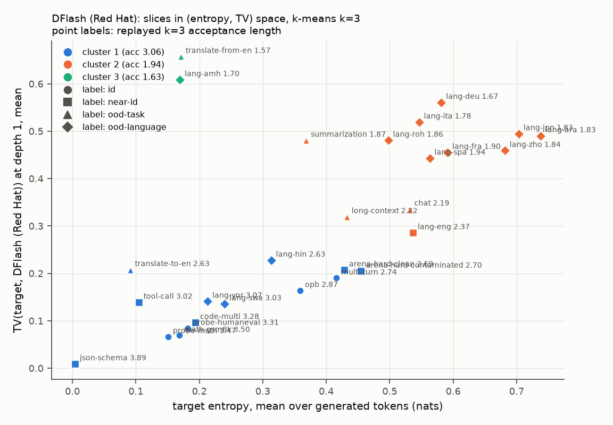
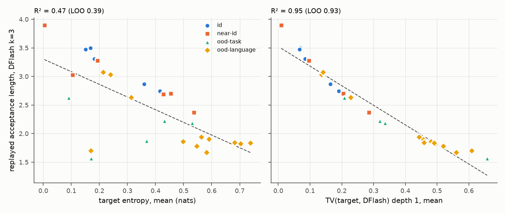
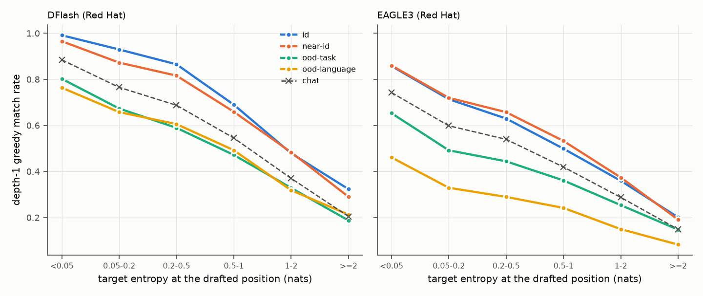
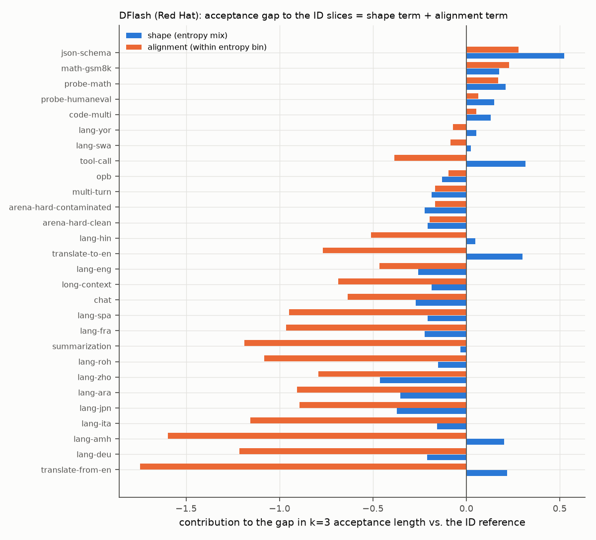
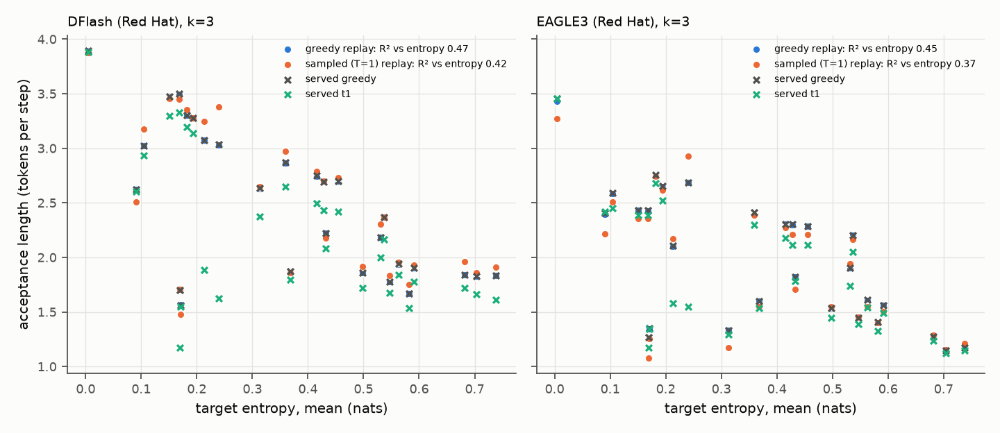
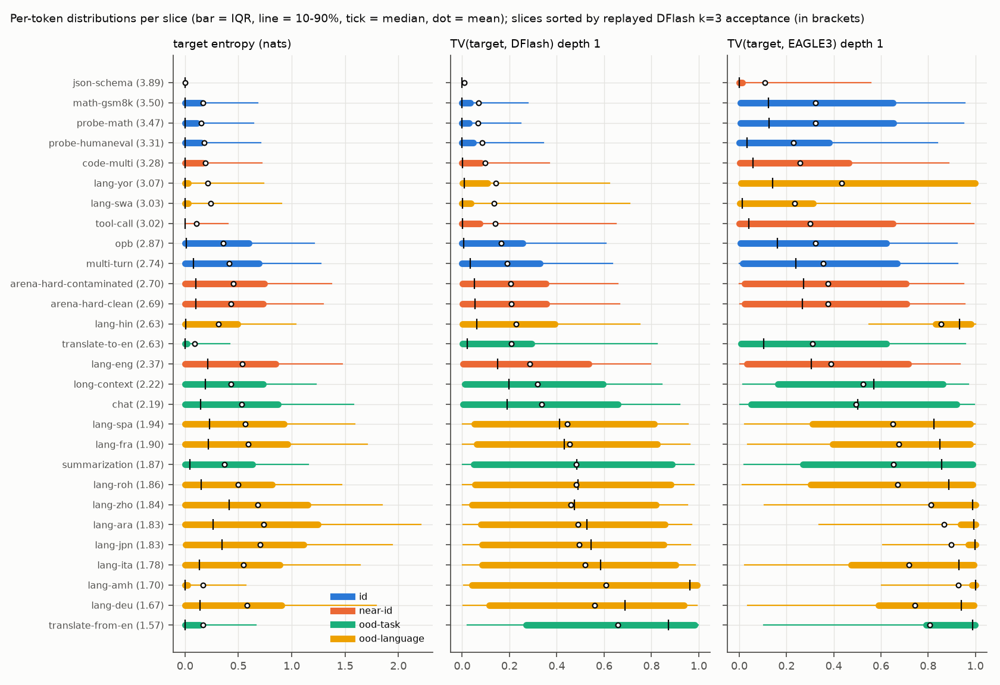
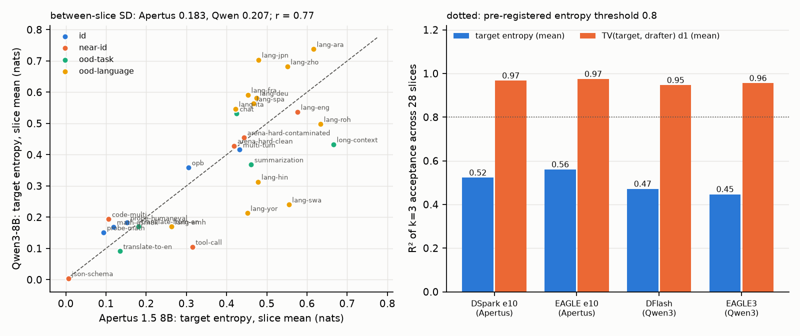

# Workload distribution shape on Qwen3-8B: entropy, alignment and acceptance

Repeat of the Apertus 1.5 8B study ([`workload-distribution-shape.md`](workload-distribution-shape.md),
job 4004306) on **Qwen/Qwen3-8B** with the official Red Hat drafters. Yu Zhu's reply to
the Apertus result: acceptance depends on (1) target entropy, (2) target-drafter
alignment and (3) greedy vs sampled drafting, and a Qwen3 model "shows a clearer
trend of the entropy". Qwen3-8B has the size of Apertus 8B, so the comparison
separates model family from size. The third factor is added as a sampled (T=1)
acceptance replay.

## Summary

**Verdict against the pre-registered rule: the entropy hypothesis fails for both drafters;
DFlash meets the alignment criterion at the threshold (chat alignment share 0.700 against
0.70) and EAGLE3 is mixed (0.66).** Read without the knife edge, Qwen3-8B repeats the
Apertus result: target entropy explains about half of the between-slice acceptance, the
drafter-target TV nearly all of it, and the non-English deficits are alignment. Chat is
the one place where the entropy mix matters more than on Apertus (a third of the gap
instead of a seventh).

- **Replay validates on Qwen3-8B.** Served vLLM 0.30 acceptance (C=1, greedy, the same
  896 prompts) against the replay, per slice: EAGLE3 k=3 r = 0.99996, mean
  |diff| 0.004; DFlash k=3 r = 0.99999, 0.002; DFlash k=15 r =
  0.99997, 0.012 tokens per step. Gate (r ≥ 0.98, ≤ 0.1) passed for both
  drafters. Served prompts have the replay's token count for 100% of requests (same
  chat rendering).
- **Entropy explains less than half; TV nearly all.** k=3 acceptance across the 28
  slices: mean target entropy R² = 0.47 (DFlash; LOO 0.39) and 0.45 (EAGLE3; LOO
  0.36); depth-1 TV R² = 0.95 and 0.96 (LOO 0.93, 0.94); both together 0.97. Over the
  896 sequences: entropy 0.43 / 0.36, TV 0.93 / 0.94. Entropy stays at 0.42-0.48 for
  k = 1 to 15; TV falls from 0.99 at k=1 to 0.67-0.80 at k=15.
- **The trend is not clearer on Qwen.** Apertus gave entropy R² 0.52 (DSpark) and 0.56
  (EAGLE). The between-slice spread of mean target entropy is about the same (SD 0.21
  vs 0.18 nats; median-entropy SD 0.12 vs 0.12), and the two targets rank the slices
  alike (r = 0.77 between their slice entropies).
- **Sampled drafting (Yu's third factor) does not change it.** The T=1 replay
  (acceptance probability 1 − TV per depth, chained along the greedy trajectory) gives
  entropy R² 0.42 (DFlash) and 0.37 (EAGLE3) against TV R² 0.94 and 0.96 at k=3. The
  served T=1 runs agree: entropy explains 0.37 (DFlash) and 0.41 (EAGLE3) of the served
  T=1 acceptance, TV 0.74 and 0.80. The sampled replay itself validates only roughly:
  r = 0.84 / 0.88 against served T=1 over all 28 slices, 0.986 / 0.987 without the four
  degenerate-language slices (below), where sampling breaks the greedy repetition loops
  (Swahili: replay 3.38, served 1.62). On the other slices the replay overestimates
  served T=1 by 0.19 (DFlash) and 0.08 (EAGLE3) tokens per step.
- **Decomposition (k=3, against the same ID reference).** Chat's gap is 0.91 tokens per
  step for DFlash: shape 0.27 (30%), alignment 0.63 (70.0%). For EAGLE3 it is 0.55:
  shape 0.19 (34%), alignment 0.37 (66%). Pooled over the 12 non-English languages,
  shape explains 15% (DFlash) and 13% (EAGLE3) of the deficit and alignment 85-87%.
  On Apertus chat was 86% alignment for both drafters. With the depth-1 match rate as
  the outcome, chat's alignment share is 61% (DFlash) and 54% (EAGLE3).
- **Low-entropy tokens.** Where the target puts ≥ ~99% on one token (entropy < 0.05
  nats), DFlash's top-1 matches on 99.2% of ID tokens, 88.5% of chat, 73% of
  summarization and 76% pooled over the languages; EAGLE3 on 86%, 74%, 55% and 46%.
  Within every entropy bin the OOD classes stay below the ID class (figure below).
- **Clusters.** k=2 on (mean entropy, mean TV) splits the same way as on Apertus (Rand
  index of the k=2 labels 0.80 for DFlash vs DSpark, 0.86 for EAGLE3 vs EAGLE): a
  well-aligned group (math, code, json, tool-call, multi-turn, opb, Arena-Hard,
  translate-to-en, plus Swahili and Yoruba, and Hindi for DFlash) and the rest (chat,
  summarization, long-context, translate-from-en, lang-eng and most languages).
- **Qwen3-8B degenerates on some low-resource languages.** Its greedy answers to the
  Swahili and Amharic prompts repeat themselves (78% and 84% repeated token 4-grams,
  against 1-16% elsewhere; Yoruba 34%, Hindi 28%), in the prompt's language. That puts
  Swahili and Yoruba among the near-deterministic, high-acceptance slices (DFlash 3.03
  and 3.07). The language slices are not a clean "flat target" test on Qwen.
- **EAGLE3's 32k draft vocabulary caps it on some scripts.** 60-71% of the tokens
  Qwen3-8B generates for Chinese, Japanese, Arabic and Amharic are outside the draft
  vocabulary, so EAGLE3 cannot draft them (TV ≈ 1, acceptance 1.15-1.27). Even on
  math 2.8% are outside it, and EAGLE3 matches only 73% at depth 1 on gsm8k (DFlash
  94%). Part of EAGLE3's "alignment" term is vocabulary coverage.

**What it means.** Model family does not rescue the entropy hypothesis: at equal size,
Qwen3-8B's slices are about as differently flat as Apertus's, and acceptance still
follows TV, not entropy. The drafter-side variables (training data coverage, draft
vocabulary) decide the workload gap; the entropy mix is a second-order term that is
largest for chat-like slices (0.2-0.3 tokens per step at k=3). The decision rule's
alignment criterion is met by DFlash only at the threshold and missed by EAGLE3, so the
honest summary is "alignment dominates, but less completely on chat than on Apertus".

## Pre-registered decision rule

Written on 2026-11-27, before any Qwen3-8B measurement, and applied per drafter. All
quantities are those of the Apertus study: replayed greedy k=3 acceptance length per
slice, 28 slices, OLS R² of acceptance on the slice mean of target entropy and on the
slice mean of depth-1 TV(target, drafter); the gap decomposition of the k=3 step
acceptance relative to the ID reference slices (opb, math-gsm8k, probe-math,
probe-humaneval, multi-turn) into a shape term (entropy mix) and an alignment term
(within entropy bin).

- **Entropy hypothesis holds** if mean-entropy R² ≥ 0.8 across slices **and** the shape
  term explains ≥ 50% of the chat gap **and** ≥ 50% of the non-English gap.
- **Alignment generalises** if the TV R² exceeds the entropy R² by ≥ 0.3 **and** the
  alignment term explains ≥ 70% of chat's gap.
- **Otherwise: mixed**; report the per-slice decomposition.

Definitions fixed with the rule: "chat gap" is the chat slice's k=3 gap to the
reference; "non-English gap" pools the 12 `lang-*` slices other than `lang-eng` (sum of
shape terms over the sum of gaps), and the per-language shares are reported as well.
A share is defined only for a deficit (gap < 0); a slice that is not below the
reference cannot satisfy a share criterion. If both criteria hold the verdict says so.
The rule is coded in `experiments/workload-shape/analyze.py` (`decision`, `RULE`).

## Setup

- **Target:** `Qwen/Qwen3-8B`, revision `b968826d9c46dd6066d109eabc6255188de91218`
  (Apache-2.0), 36 layers, bf16. Chat template with `enable_thinking=False`
  (the corpus rows carry `chat_template_kwargs: {enable_thinking: false}`). Contract:
  [`targets/qwen3-8b/contract.json`](../targets/qwen3-8b/contract.json).
- **EAGLE3 drafter:** `RedHatAI/Qwen3-8B-speculator.eagle3`, revision
  `08610ffa01dd9f16731fe8f627b85905b6aa51c4` (Apache-2.0, speculators 0.2.0.dev11):
  one llama layer, hidden 4096, draft vocabulary 32,000 mapped to the 151,936-token
  target vocabulary through `d2t` (probability 0 outside the draft vocabulary for TV),
  `norm_before_residual`, default RoPE θ = 1e6, card k = 3. The aux layers are not in
  its config; vLLM's default for a Qwen3 target without
  `eagle_aux_hidden_state_layer_ids` is (2, 18, 33) (vLLM ids; HF decoder layers 1, 17,
  32), which is also speculators' data-generation default. The validation gate
  confirms them. Card: trained on ShareGPT (Aeala/ShareGPT_Vicuna_unfiltered) and
  UltraChat 200k, "trained with thinking disabled".
- **DFlash drafter:** `RedHatAI/Qwen3-8B-speculator.dflash`, revision
  `1a11b170eb65c8a62c80ecd01dfe22a5907298e6` (Apache-2.0, speculators 0.7.0.dev120):
  `DFlashDraftModel`, 5 Qwen3 layers with sliding window 2048 and a causal in-block
  mask, block 16 (15 drafted tokens, `sample_from_anchor` false), aux layers
  [2, 10, 18, 26, 34] (vLLM ids; HF decoder layers 1, 9, 17, 25, 33), mask token
  151669, full vocabulary, no Markov head; card k = 15. Card and `train_command.txt`:
  Magpie-Llama-3.1-Pro-300K-Filtered, UltraChat 200k `train_sft` and
  Nemotron-Personas, responses regenerated by Qwen3-8B without reasoning, 20 epochs,
  D-PACE loss weighting, Muon, sequence length 65,536.
- Neither drafter saw OPB, the Apertus drafters' training corpus. The ID/OOD labels of
  the suite were fixed for the Apertus drafters and are kept as labels only; the
  decomposition's ID reference is the same five slices.

## Method

Unchanged from the Apertus study unless listed: the same 28 slices × 32 prompts (frozen
corpus `7d8e60ef...`, prompt ids of
[`results/8b/workload-shape/inputs/suite.yaml`](../results/8b/workload-shape/inputs/suite.yaml)),
greedy target trajectories from plain vLLM (C=1, 512-token cap, thinking off), one HF
teacher-forced pass of the target per sequence, both drafters evaluated on the same
hidden states, greedy-chain replay, R² with leave-one-out, decomposition, k-means.

Differences:

- Prompts are rendered with Qwen3's own chat template and tokenizer
  (`target.prompt_render: chat_template` in the contract), so caps and positions are
  Qwen tokens.
- Drafter model code: `apertus_tree.qwen_heads` (`Eagle3Speculators`, `DFlash`),
  written from the speculators source and from vLLM 0.30's serving code. Unit tests in
  [`tests/test_shape.py`](../tests/test_shape.py) compare each head's logits with the
  vendored reference layers ([`tests/reference_speculators.py`](../tests/reference_speculators.py))
  on one sequence (tolerance 1e-3).
- DFlash depth d reads block slot d (slot 0 is the anchor); replay depth 15 for both
  drafters, so k = 1, 3, 5, 7 and 15 are replayed.
- Sampled (T=1) replay: with rejection sampling, a drafted token at depth d is accepted
  with probability 1 − TV(p_d, q_d). The expected acceptance length of a step that
  starts at anchor a is 1 + Σ_{j≤k} Π_{d≤j} (1 − TV_d), evaluated along the greedy
  trajectory at every anchor (`shape_aggregate --sampled`).
- Validation gate: Qwen3-8B served in vLLM 0.30 (`vllm_nvidia_alps-arm64.sqsh`) with
  each drafter, TP1, C=1, on the same 896 prompts and caps, through `apertus_bench`
  ([`submit-gate-qwen3.sh`](../experiments/workload-shape/submit-gate-qwen3.sh)):
  EAGLE3 k=3, DFlash k=3 and k=15 greedy, and EAGLE3 / DFlash k=3 at T=1.
  **Gate:** replay vs served acceptance per slice, Pearson r ≥ 0.98 and mean absolute
  difference ≤ 0.1 tokens per step, per drafter. No conclusion is drawn from a drafter
  whose replay fails the gate.

## Results

Run: [`full-20261127-4052231/`](../results/qwen3-8b/workload-shape/full-20261127-4052231); gate: [`gate-20261127-4052232/`](../results/qwen3-8b/workload-shape/gate-20261127-4052232).

### Decision rule, per drafter

| | DFlash (Red Hat) | EAGLE3 (Red Hat) |
|---|---|---|
| R² k=3 on mean target entropy (LOO) | 0.47 (0.39) | 0.45 (0.36) |
| R² k=3 on mean depth-1 TV (LOO) | 0.95 (0.93) | 0.96 (0.94) |
| TV R² − entropy R² | 0.48 | 0.51 |
| chat gap (tokens/step) | −0.91 | −0.55 |
| chat: shape share / alignment share | 0.30 / **0.700** | 0.34 / 0.66 |
| non-English gap, 12 languages pooled | −12.0 (sum) | −10.9 (sum) |
| non-English: shape share | 0.15 | 0.13 |
| entropy hypothesis (R² ≥ 0.8, shape ≥ 50% of both gaps) | no | no |
| alignment generalises (ΔR² ≥ 0.3, alignment ≥ 70% of chat) | yes (0.7003) | no (0.664) |
| **verdict** | **alignment generalises (at the threshold)** | **mixed** |

Per-language shape shares (DFlash / EAGLE3): deu 0.15 / 0.17, fra 0.19 / 0.22, ita 0.12 /
0.15, spa 0.18 / 0.21, roh 0.12 / 0.15, zho 0.37 / 0.27, jpn 0.29 / 0.22, ara 0.28 /
0.22, hin −0.10 / −0.05, amh −0.15 / −0.15; Swahili and Yoruba have almost no gap for
DFlash (−0.06, −0.02) and none for EAGLE3 on Swahili (+0.23), so their shares are not
meaningful. Values in [`analysis.json`](../results/qwen3-8b/workload-shape/full-20261127-4052231/analysis.json) (`decision`).

### Validation gate

| arm (served, C=1, 896 prompts) | replay vs served: Pearson r | mean abs diff | mean diff (replay − served) | gate |
|---|---|---|---|---|
| EAGLE3 k=3 greedy | 0.99996 | 0.004 | −0.004 | pass |
| DFlash k=3 greedy | 0.99999 | 0.002 | −0.001 | pass |
| DFlash k=15 greedy | 0.99997 | 0.012 | −0.003 | pass |
| EAGLE3 k=3 T=1 (sampled replay) | 0.879 (0.987 without swa/yor/amh/hin) | 0.148 (0.081) | +0.089 | not gated |
| DFlash k=3 T=1 (sampled replay) | 0.840 (0.986 without swa/yor/amh/hin) | 0.299 (0.185) | +0.287 | not gated |

All 4,480 served requests succeeded. Every served prompt had the replay's prompt
length (same chat rendering), and 99.8% (EAGLE3 k=3), 99.9% (DFlash k=3) and 97.8%
(DFlash k=15) of the greedy completions had the captured length. vLLM logs the EAGLE3
aux layers it used, (2, 18, 33), which confirms the replay's choice. Served k=3
acceptance gives the same fits as the replay: entropy R² 0.47 (DFlash) and 0.45
(EAGLE3), TV 0.95 and 0.95. Cells:
[`served-acceptance.json`](../results/qwen3-8b/workload-shape/gate-20261127-4052232/served-acceptance.json).

The (entropy, TV) map for DFlash; EAGLE3 in
[`shape-map-eagle3.png`](../results/qwen3-8b/workload-shape/full-20261127-4052231/figures/shape-map-eagle3.png).

EAGLE3: [`acceptance-vs-shape-eagle3.png`](../results/qwen3-8b/workload-shape/full-20261127-4052231/figures/acceptance-vs-shape-eagle3.png).

EAGLE3: [`gap-decomposition-eagle3.png`](../results/qwen3-8b/workload-shape/full-20261127-4052231/figures/gap-decomposition-eagle3.png).

Greedy and sampled (T=1) replay against mean target entropy, with the served cells.

### Per-slice statistics

Entropy in nats; TV and match at depth 1; acceptance length = tokens per step (k=3,
accepted drafts + 1); "served" is the gate's vLLM counter (C=1, greedy).

| slice | class | target H median [IQR] | target top-1 median | DFlash TV d1 median [IQR] | DFlash match d1 | DFlash acc k3 replay / served | EAGLE3 TV d1 median [IQR] | EAGLE3 match d1 | EAGLE3 acc k3 replay / served |
|---|---|---|---|---|---|---|---|---|---|
| opb | id | 0.011 [0.000, 0.600] | 0.999 | 0.007 [0.000, 0.257] | 0.848 | 2.87 / 2.87 | 0.162 [0.006, 0.622] | 0.715 | 2.40 / 2.41 |
| math-gsm8k | id | 0.000 [0.000, 0.154] | 1.000 | 0.000 [0.000, 0.035] | 0.943 | 3.50 / 3.50 | 0.123 [0.005, 0.651] | 0.730 | 2.43 / 2.43 |
| probe-math | id | 0.000 [0.000, 0.112] | 1.000 | 0.000 [0.000, 0.029] | 0.941 | 3.47 / 3.47 | 0.126 [0.005, 0.652] | 0.736 | 2.43 / 2.43 |
| probe-humaneval | id | 0.000 [0.000, 0.153] | 1.000 | 0.000 [0.000, 0.047] | 0.923 | 3.31 / 3.30 | 0.033 [0.001, 0.380] | 0.807 | 2.76 / 2.76 |
| multi-turn | id | 0.082 [0.000, 0.696] | 0.987 | 0.033 [0.000, 0.328] | 0.825 | 2.74 / 2.75 | 0.241 [0.016, 0.669] | 0.685 | 2.31 / 2.31 |
| code-multi | near-id | 0.000 [0.000, 0.171] | 1.000 | 0.001 [0.000, 0.079] | 0.917 | 3.28 / 3.28 | 0.058 [0.002, 0.464] | 0.786 | 2.65 / 2.65 |
| json-schema | near-id | 0.000 [0.000, 0.000] | 1.000 | 0.000 [0.000, 0.000] | 0.997 | 3.89 / 3.89 | 0.001 [0.000, 0.013] | 0.924 | 3.43 / 3.46 |
| tool-call | near-id | 0.000 [0.000, 0.000] | 1.000 | 0.000 [0.000, 0.075] | 0.879 | 3.02 / 3.02 | 0.041 [0.001, 0.650] | 0.775 | 2.59 / 2.59 |
| lang-eng | near-id | 0.213 [0.001, 0.847] | 0.957 | 0.151 [0.004, 0.534] | 0.729 | 2.37 / 2.37 | 0.305 [0.034, 0.716] | 0.648 | 2.21 / 2.21 |
| arena-hard-clean | near-id | 0.101 [0.000, 0.730] | 0.982 | 0.055 [0.001, 0.356] | 0.811 | 2.69 / 2.69 | 0.266 [0.024, 0.709] | 0.679 | 2.30 / 2.30 |
| arena-hard-contaminated | near-id | 0.103 [0.000, 0.742] | 0.982 | 0.052 [0.000, 0.355] | 0.811 | 2.70 / 2.70 | 0.272 [0.024, 0.705] | 0.678 | 2.29 / 2.29 |
| chat | ood-task | 0.144 [0.000, 0.872] | 0.973 | 0.189 [0.004, 0.658] | 0.681 | 2.19 / 2.19 | 0.501 [0.050, 0.921] | 0.553 | 1.90 / 1.91 |
| summarization | ood-task | 0.048 [0.000, 0.631] | 0.993 | 0.483 [0.051, 0.888] | 0.575 | 1.87 / 1.88 | 0.858 [0.269, 0.989] | 0.422 | 1.60 / 1.60 |
| long-context | ood-task | 0.188 [0.001, 0.732] | 0.962 | 0.197 [0.011, 0.596] | 0.696 | 2.22 / 2.22 | 0.570 [0.165, 0.862] | 0.555 | 1.82 / 1.82 |
| translate-to-en | ood-task | 0.000 [0.000, 0.020] | 1.000 | 0.022 [0.001, 0.294] | 0.823 | 2.63 / 2.62 | 0.104 [0.008, 0.622] | 0.757 | 2.39 / 2.41 |
| translate-from-en | ood-task | 0.002 [0.000, 0.142] | 1.000 | 0.871 [0.270, 0.983] | 0.432 | 1.57 / 1.56 | 0.989 [0.791, 0.999] | 0.276 | 1.35 / 1.35 |
| lang-deu | ood-language | 0.138 [0.001, 0.904] | 0.976 | 0.688 [0.115, 0.937] | 0.487 | 1.67 / 1.67 | 0.941 [0.589, 0.995] | 0.312 | 1.41 / 1.41 |
| lang-fra | ood-language | 0.216 [0.001, 0.960] | 0.957 | 0.433 [0.061, 0.823] | 0.590 | 1.90 / 1.91 | 0.849 [0.396, 0.978] | 0.394 | 1.56 / 1.56 |
| lang-ita | ood-language | 0.133 [0.000, 0.887] | 0.977 | 0.586 [0.085, 0.901] | 0.534 | 1.78 / 1.78 | 0.931 [0.474, 0.993] | 0.337 | 1.45 / 1.45 |
| lang-spa | ood-language | 0.229 [0.000, 0.927] | 0.953 | 0.410 [0.053, 0.811] | 0.600 | 1.94 / 1.94 | 0.824 [0.311, 0.977] | 0.417 | 1.61 / 1.61 |
| lang-roh | ood-language | 0.153 [0.000, 0.818] | 0.972 | 0.490 [0.053, 0.882] | 0.568 | 1.86 / 1.86 | 0.886 [0.303, 0.989] | 0.387 | 1.53 / 1.53 |
| lang-zho | ood-language | 0.413 [0.004, 1.148] | 0.904 | 0.475 [0.042, 0.820] | 0.562 | 1.84 / 1.84 | 0.989 [0.815, 1.000] | 0.230 | 1.27 / 1.27 |
| lang-jpn | ood-language | 0.346 [0.006, 1.110] | 0.920 | 0.545 [0.085, 0.852] | 0.557 | 1.83 / 1.83 | 0.998 [0.971, 1.000] | 0.139 | 1.15 / 1.15 |
| lang-hin | ood-language | 0.008 [0.000, 0.492] | 0.999 | 0.062 [0.002, 0.392] | 0.807 | 2.63 / 2.63 | 0.934 [0.831, 0.981] | 0.265 | 1.33 / 1.33 |
| lang-ara | ood-language | 0.261 [0.003, 1.245] | 0.952 | 0.528 [0.078, 0.856] | 0.562 | 1.83 / 1.84 | 0.994 [0.938, 1.000] | 0.162 | 1.17 / 1.17 |
| lang-swa | ood-language | 0.001 [0.000, 0.027] | 1.000 | 0.001 [0.000, 0.038] | 0.887 | 3.03 / 3.04 | 0.013 [0.002, 0.311] | 0.806 | 2.69 / 2.69 |
| lang-yor | ood-language | 0.001 [0.000, 0.029] | 1.000 | 0.010 [0.000, 0.106] | 0.890 | 3.07 / 3.07 | 0.140 [0.008, 0.999] | 0.611 | 2.10 / 2.11 |
| lang-amh | ood-language | 0.003 [0.000, 0.026] | 1.000 | 0.963 [0.042, 0.992] | 0.433 | 1.70 / 1.70 | 1.000 [0.985, 1.000] | 0.215 | 1.27 / 1.27 |

#### Acceptance length per k (greedy replay; sampled T=1 replay in brackets)

| slice | DFlash k1 | DFlash k3 | DFlash k5 | DFlash k7 | DFlash k15 | EAGLE3 k1 | EAGLE3 k3 | EAGLE3 k5 | EAGLE3 k7 | EAGLE3 k15 |
|---|---|---|---|---|---|---|---|---|---|---|
| opb | 1.83 (1.84) | 2.87 (2.97) | 3.38 (3.73) | 3.65 (4.28) | 3.96 (5.39) | 1.70 (1.68) | 2.40 (2.39) | 2.61 (2.63) | 2.69 (2.71) | 2.73 (2.76) |
| math-gsm8k | 1.94 (1.93) | 3.50 (3.45) | 4.64 (4.60) | 5.42 (5.49) | 6.75 (7.44) | 1.72 (1.68) | 2.43 (2.35) | 2.60 (2.54) | 2.66 (2.59) | 2.69 (2.60) |
| probe-math | 1.94 (1.93) | 3.47 (3.45) | 4.60 (4.58) | 5.35 (5.42) | 6.64 (7.17) | 1.72 (1.68) | 2.43 (2.36) | 2.64 (2.56) | 2.70 (2.62) | 2.73 (2.64) |
| probe-humaneval | 1.92 (1.92) | 3.31 (3.36) | 4.21 (4.44) | 4.74 (5.31) | 5.68 (7.57) | 1.79 (1.77) | 2.76 (2.74) | 3.14 (3.17) | 3.26 (3.36) | 3.37 (3.51) |
| multi-turn | 1.81 (1.81) | 2.74 (2.79) | 3.16 (3.35) | 3.34 (3.73) | 3.54 (4.52) | 1.67 (1.64) | 2.31 (2.27) | 2.49 (2.47) | 2.54 (2.55) | 2.57 (2.62) |
| code-multi | 1.91 (1.90) | 3.28 (3.28) | 4.12 (4.23) | 4.65 (4.92) | 5.30 (6.33) | 1.77 (1.74) | 2.65 (2.62) | 2.98 (2.94) | 3.10 (3.05) | 3.15 (3.11) |
| json-schema | 2.00 (1.99) | 3.89 (3.87) | 5.70 (5.63) | 7.28 (7.25) | 11.32 (11.51) | 1.91 (1.89) | 3.43 (3.27) | 4.27 (4.10) | 4.87 (4.57) | 5.58 (5.04) |
| tool-call | 1.86 (1.86) | 3.02 (3.17) | 3.67 (4.20) | 4.05 (5.03) | 4.51 (6.79) | 1.76 (1.70) | 2.59 (2.51) | 2.93 (2.85) | 3.10 (3.00) | 3.18 (3.11) |
| lang-eng | 1.72 (1.71) | 2.37 (2.37) | 2.56 (2.60) | 2.63 (2.69) | 2.67 (2.76) | 1.63 (1.61) | 2.21 (2.17) | 2.34 (2.31) | 2.39 (2.34) | 2.40 (2.35) |
| arena-hard-clean | 1.80 (1.79) | 2.69 (2.70) | 3.05 (3.16) | 3.22 (3.42) | 3.34 (3.79) | 1.66 (1.62) | 2.30 (2.21) | 2.47 (2.38) | 2.52 (2.43) | 2.54 (2.46) |
| arena-hard-contaminated | 1.80 (1.80) | 2.70 (2.73) | 3.08 (3.21) | 3.25 (3.50) | 3.40 (3.95) | 1.66 (1.62) | 2.29 (2.21) | 2.45 (2.37) | 2.51 (2.43) | 2.54 (2.47) |
| chat | 1.64 (1.66) | 2.19 (2.30) | 2.34 (2.57) | 2.40 (2.69) | 2.43 (2.79) | 1.52 (1.51) | 1.90 (1.94) | 2.00 (2.07) | 2.03 (2.11) | 2.04 (2.14) |
| summarization | 1.54 (1.52) | 1.87 (1.86) | 1.93 (1.95) | 1.95 (1.98) | 1.95 (1.99) | 1.39 (1.35) | 1.60 (1.55) | 1.62 (1.58) | 1.62 (1.58) | 1.62 (1.58) |
| long-context | 1.69 (1.68) | 2.22 (2.18) | 2.33 (2.30) | 2.36 (2.34) | 2.37 (2.36) | 1.54 (1.48) | 1.82 (1.71) | 1.84 (1.73) | 1.84 (1.74) | 1.84 (1.74) |
| translate-to-en | 1.82 (1.79) | 2.63 (2.51) | 2.85 (2.71) | 2.91 (2.77) | 2.92 (2.82) | 1.75 (1.69) | 2.39 (2.22) | 2.50 (2.31) | 2.52 (2.33) | 2.53 (2.35) |
| translate-from-en | 1.40 (1.34) | 1.57 (1.48) | 1.59 (1.50) | 1.60 (1.51) | 1.60 (1.51) | 1.26 (1.19) | 1.35 (1.26) | 1.35 (1.26) | 1.35 (1.27) | 1.36 (1.27) |
| lang-deu | 1.43 (1.44) | 1.67 (1.75) | 1.72 (1.85) | 1.74 (1.88) | 1.74 (1.89) | 1.28 (1.26) | 1.41 (1.41) | 1.43 (1.43) | 1.44 (1.44) | 1.44 (1.44) |
| lang-fra | 1.55 (1.54) | 1.90 (1.93) | 1.98 (2.05) | 2.00 (2.09) | 2.01 (2.12) | 1.37 (1.32) | 1.56 (1.50) | 1.59 (1.54) | 1.60 (1.54) | 1.60 (1.54) |
| lang-ita | 1.49 (1.48) | 1.78 (1.83) | 1.85 (1.95) | 1.86 (2.01) | 1.87 (2.08) | 1.31 (1.28) | 1.45 (1.45) | 1.47 (1.49) | 1.48 (1.51) | 1.48 (1.52) |
| lang-spa | 1.57 (1.56) | 1.94 (1.95) | 2.02 (2.07) | 2.05 (2.11) | 2.06 (2.13) | 1.40 (1.35) | 1.61 (1.55) | 1.64 (1.59) | 1.65 (1.60) | 1.65 (1.60) |
| lang-roh | 1.53 (1.52) | 1.86 (1.92) | 1.94 (2.06) | 1.96 (2.12) | 1.97 (2.25) | 1.35 (1.33) | 1.53 (1.55) | 1.57 (1.61) | 1.57 (1.64) | 1.58 (1.67) |
| lang-zho | 1.51 (1.54) | 1.84 (1.96) | 1.92 (2.11) | 1.94 (2.17) | 1.96 (2.24) | 1.20 (1.19) | 1.27 (1.29) | 1.28 (1.31) | 1.28 (1.31) | 1.28 (1.31) |
| lang-jpn | 1.51 (1.51) | 1.83 (1.86) | 1.89 (1.97) | 1.91 (2.01) | 1.92 (2.06) | 1.12 (1.10) | 1.15 (1.15) | 1.15 (1.16) | 1.15 (1.16) | 1.15 (1.16) |
| lang-hin | 1.78 (1.77) | 2.63 (2.65) | 2.95 (3.06) | 3.07 (3.26) | 3.16 (3.38) | 1.26 (1.14) | 1.33 (1.17) | 1.34 (1.17) | 1.34 (1.17) | 1.34 (1.17) |
| lang-ara | 1.51 (1.51) | 1.83 (1.91) | 1.91 (2.06) | 1.94 (2.13) | 1.95 (2.21) | 1.13 (1.13) | 1.17 (1.21) | 1.18 (1.23) | 1.18 (1.24) | 1.18 (1.25) |
| lang-swa | 1.84 (1.86) | 3.03 (3.38) | 3.76 (4.69) | 4.19 (5.81) | 4.89 (8.03) | 1.74 (1.77) | 2.69 (2.93) | 3.14 (3.74) | 3.49 (4.31) | 3.87 (5.46) |
| lang-yor | 1.86 (1.86) | 3.07 (3.25) | 3.88 (4.31) | 4.27 (5.08) | 4.59 (6.48) | 1.61 (1.57) | 2.10 (2.17) | 2.25 (2.49) | 2.31 (2.75) | 2.38 (3.64) |
| lang-amh | 1.40 (1.39) | 1.70 (1.71) | 1.72 (1.72) | 1.72 (1.72) | 1.72 (1.72) | 1.22 (1.07) | 1.27 (1.08) | 1.27 (1.08) | 1.27 (1.08) | 1.27 (1.08) |

### R² across k, greedy and sampled

Slice level (28 points), mean target entropy / mean depth-1 TV / both:

| k | DFlash greedy | DFlash sampled | EAGLE3 greedy | EAGLE3 sampled |
|---|---|---|---|---|
| 1 | 0.39 / 0.99 / 1.00 | 0.34 / 1.00 / 1.00 | 0.44 / 0.98 / 0.99 | 0.35 / 1.00 / 1.00 |
| 3 | 0.47 / 0.95 / 0.97 | 0.42 / 0.94 / 0.95 | 0.45 / 0.96 / 0.97 | 0.37 / 0.96 / 0.96 |
| 5 | 0.48 / 0.87 / 0.91 | 0.44 / 0.88 / 0.90 | 0.44 / 0.91 / 0.93 | 0.38 / 0.89 / 0.90 |
| 7 | 0.48 / 0.81 / 0.86 | 0.45 / 0.83 / 0.86 | 0.44 / 0.86 / 0.88 | 0.37 / 0.84 / 0.85 |
| 15 | 0.45 / 0.67 / 0.73 | 0.45 / 0.75 / 0.79 | 0.42 / 0.80 / 0.83 | 0.34 / 0.73 / 0.74 |

Depth-1 TV loses explanatory power with k because deeper acceptance depends on deeper
TV (DFlash's match rate decays from 0.68 at depth 1 to 0.08 at depth 15 on chat);
entropy does not gain it. Sequence level (896 points, k=3): entropy 0.43 / 0.36, TV
0.93 / 0.94 (DFlash / EAGLE3); correlation of entropy and TV over sequences 0.58 /
0.54. Leave-one-out and the remaining fits are in `analysis.json` (`r2_slices`,
`r2_sequences`).

### Cross-model comparison (Apertus 1.5 8B vs Qwen3-8B)

[`cross-model.json`](../results/qwen3-8b/workload-shape/cross-model/cross-model.json)
(`experiments/workload-shape/cross_model.py`):

| | Apertus 8B | Qwen3-8B |
|---|---|---|
| slice mean target entropy: mean / SD / range (nats) | 0.38 / 0.18 / 0.66 | 0.37 / 0.21 / 0.73 |
| slice median target entropy: SD | 0.12 | 0.12 |
| block drafter: entropy R² / TV R² (k=3) | DSpark 0.52 / 0.97 | DFlash 0.47 / 0.95 |
| EAGLE: entropy R² / TV R² (k=3) | EAGLE e10 0.56 / 0.98 | EAGLE3 0.45 / 0.96 |
| chat: alignment share (block / EAGLE) | 0.86 / 0.85 | 0.70 / 0.66 |
| 12 languages: alignment share (block / EAGLE) | 0.85 / 0.84 | 0.85 / 0.87 |
| k=3 acceptance across slices: SD (block / EAGLE) | 0.80 / 0.79 | 0.67 / 0.60 |

- **Is the entropy trend clearer on Qwen?** No. The slices differ in flatness by about
  as much (SD 0.21 vs 0.18 nats of the slice means), the two targets agree on which
  slices are flat (r = 0.77), and entropy explains slightly less of the acceptance on
  Qwen (0.45-0.47 vs 0.52-0.56).
- **Cluster membership** of the k=2 split is largely shared (Rand index 0.80 DFlash vs
  DSpark, 0.86 EAGLE3 vs EAGLE e10). The moves: Swahili and Yoruba (and Hindi for
  DFlash) join the well-aligned group on Qwen, through the degenerate repetitive
  outputs above.
- **EAGLE3 vs EAGLE e10** (different targets, so a drafter-and-target contrast):
  EAGLE3 accepts 0.98 tokens per step less on the ID slices, 0.45 less near-ID, 0.23 less
  on OOD tasks and 0.17 less on languages; its depth-1 TV is 0.11-0.22 higher
  everywhere. Per-slice acceptances correlate at r = 0.81. EAGLE3 is a weak head
  (card k=3 2.39-2.48 on HumanEval/gsm8k at T=0.6), with a 32k draft vocabulary.
- **DFlash vs DSpark e10**: DFlash accepts 0.33 less on ID, 0.12 less near-ID, 0.16 less
  on OOD tasks and 0.34 *more* on the languages (r = 0.81 per slice). DSpark's ID slices
  are its training distribution (OPB); DFlash's training mix (Magpie, UltraChat,
  Nemotron-Personas, regenerated by Qwen3-8B) is broader chat.
- **Confounder: the drafters' training data differ from ours.** The Apertus heads were
  trained on OPB (math 44%, multi-turn 25%, code 13%), which defines the suite's ID
  labels. Red Hat's heads saw ShareGPT + UltraChat (EAGLE3) and Magpie + UltraChat +
  Nemotron-Personas (DFlash), so "ID" here is a label, not the drafters' distribution;
  the decomposition's reference set is kept for comparability. That the TV-vs-entropy
  picture survives this change of training data is the robust finding; the size of
  each slice's alignment term is not comparable across the two models.

### Other observations

- **Variance within a slice** is again large: DFlash k=3 per-sequence acceptance on chat
  spans 1.56 (10th percentile) to 2.80 (90th), OPB 2.27 to 3.67; math-gsm8k is tight
  (3.30-3.68), lang-deu too (1.56-1.77).
- **Per-depth decay.** DFlash's conditional match rate decays steeply with depth (math
  0.94 → 0.32 at depth 15, chat 0.68 → 0.08); EAGLE3's starts lower and stays flatter
  (math 0.73 → 0.36, chat 0.55 → 0.28), as for DSpark vs EAGLE on Apertus.
- **HF/vLLM agreement.** The HF target's argmax equals the vLLM greedy token on
  98.9% (lang-jpn) to 100% of positions per slice. Served greedy completions have the captured length
  for 97.8% (DFlash k=15) to 99.9% of requests (the gate's speculative engines vs the replay's plain
  engine).
- **Output language** (`output-language.json`, aggregates of the cluster-side check):
  Qwen3-8B answers the language prompts in their language (English function-word share
  ≤ 0.12 on every `lang-*` slice except lang-eng), and chat outputs are 17/32
  English-like.

### Caveats

- One greedy trajectory per prompt, 512-token cap, thinking off, 32 prompts per slice;
  28 slice points (12 from one language source). The DFlash alignment criterion passes
  by 0.0003 on the chat share, well inside the noise of 32 prompts; treat the two
  drafters' verdicts as the same finding.
- The sampled replay evaluates 1 − TV along the greedy trajectory at every anchor; real
  T=1 decoding follows sampled trajectories and starts steps after accepted runs. The
  served T=1 check bounds the error (above).
- EAGLE3's TV counts the target mass outside its draft vocabulary as disagreement,
  which is what limits its served acceptance, but mixes vocabulary coverage into the
  alignment term. KL(p‖q) is infinite for EAGLE3 and is not fitted.
- DFlash's sliding window is applied as in training (context [a − 2048, a) for every
  slot); vLLM's per-query window differs by at most 15 positions at the window edge,
  which the gate shows is immaterial.
- The ID reference of the decomposition and the class labels are those of the Apertus
  suite (see the confounder above).

## Reproducibility

- Runs (account d_research_serving, partition normal, one node, 4 GH200 each): replay
  job 4052231 (nid006219, 16.7 min); gate job 4052232 (nid007595, 48.3 min). Smoke
  and setup jobs: 4051595 (download, CPU), 4052152 (debug, cancelled in the queue:
  QOS limit), 4052166 (failed in 21 s: no pytest in the image), 4052176 (failed: a
  stale pytest plugin in the shared pydeps; fixed with PYTEST_DISABLE_PLUGIN_AUTOLOAD=1),
  4052191 (smoke, 2 prompts per shard, passed), 4052171 (gate smoke, 3 slices, passed).
  Compute: 80.8 node-minutes on 4-GPU nodes = 5.4 GPU-hours allocated (replay 1.1, gate 3.2, smokes and failures 1.0, download 0.1).
- Code: branch `experiment/workload-shape-qwen3-8b`, source commit `fabc7d1a` (a `git
  archive` copy of methods/, src/, tests/, targets/, serving/, experiments/workload-shape/
  and the suite inputs at
  `/iopsstor/scratch/cscs/faruk_zahiragic/spec-exp/workload-shape-qwen3-8b/code-fabc7d1a73b0`
  with `SOURCE_REVISION`; tarball sha256 `5166fd19ec6592a4...`). The home checkout is
  over quota, so the checkout lives under the scratch `spec-exp/` tree. Pytest: 5
  passed in the image (`logs/pytest-4052231.txt`).
  `gate_summary.py` and `output_language_check.py` ran on the login node from commit
  `fd27e747` (copied to `spec-exp/workload-shape-qwen3-8b/tools-fd27e747`);
  `analyze.py` and `cross_model.py` ran locally at `fd27e747` (`analyze.py` is unchanged
  since `85950b39`).
- Image: `vllm_nvidia_alps-arm64.sqsh` (vLLM 0.30.0), sha256
  `d259b3fb40615d406febc094ae8509bc1aa588f97c4d738677d988ac997d7a90`, the image of the
  Qwen3-235B run.
- Target `Qwen/Qwen3-8B` `b968826d`, weight manifest `10a8b251...`; EAGLE3
  `08610ffa`, `model.safetensors` sha256 `ca1fa9bb...`; DFlash `1a11b170`,
  `afda7616...`. Every LFS file matched the Hub's SHA-256; manifests, configs, cards and
  DFlash's `train_command.txt` / `training_state.json` are in
  [`inputs/models/`](../results/qwen3-8b/workload-shape/inputs/models) (the DFlash
  optimizer and scheduler states were not downloaded).
- Corpus: the frozen task-speed corpus `7d8e60ef...` (measured rows `fdba706e...`),
  copied from the Apertus run's scratch inputs and checked against the frozen digest.
- [`full-20261127-4052231/`](../results/qwen3-8b/workload-shape/full-20261127-4052231) holds the aggregates, sequence table, analysis,
  tables, figures, shard summaries, capture metadata (token ids removed), the sbatch
  file, environment, provenance, pytest log, output-language aggregates and
  [`cluster-only-sha256.txt`](../results/qwen3-8b/workload-shape/full-20261127-4052231/cluster-only-sha256.txt) (captures, npz shards,
  corpus), which stay on Clariden under
  `/iopsstor/scratch/cscs/faruk_zahiragic/workload-shape-qwen3-8b/runs/full-20261127/`
  (restricted prompts; scratch is purgeable). The gate directory holds, per arm, the
  launch command, `arm.env`, status, server and bench logs and every cell's
  `metadata.json`, `requests.jsonl`, `summary.json` and metric snapshots.
- Re-run (on the cluster, from the code copy):
  `source inputs/qwen-env.sh` (target, heads, `SHAPE_ARGS`, `AGG_ARGS`, pydeps), then
  `APERTUS_EAGLE_CONTRACT=targets/qwen3-8b/contract.json
  SHAPE_ENV_SOURCE=experiments/workload-shape/qwen3-env.toml
  experiments/workload-shape/submit-shape.sh RUN_DIR`;
  `GATE_CORPUS=RUN_DIR/inputs/corpus-measured.jsonl experiments/workload-shape/submit-gate-qwen3.sh GATE_DIR`;
  `gate_summary.py GATE_DIR served-acceptance.json RUN_DIR/captures/shard-*.json`;
  locally `analyze.py RUN_DIR results/qwen3-8b/workload-shape/inputs --served
  served-acceptance.json --extended` and `cross_model.py`.
- The Apertus pipeline is unchanged by these edits: on the archived Apertus shards,
  `shape_aggregate` rewrites `aggregate.json` and `sequences.csv` byte for byte, and
  `analyze.py` rewrites `analysis.json` and `tables.md` byte for byte.
