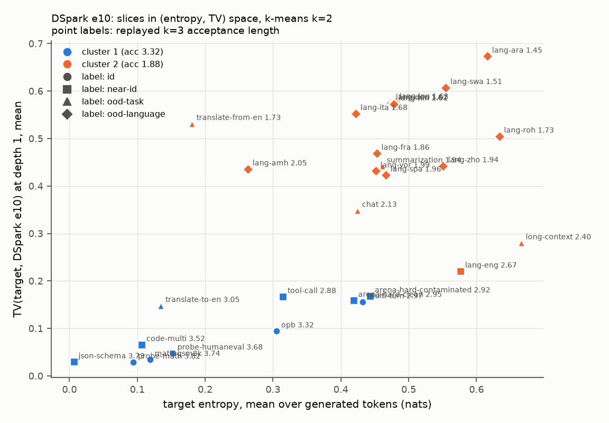
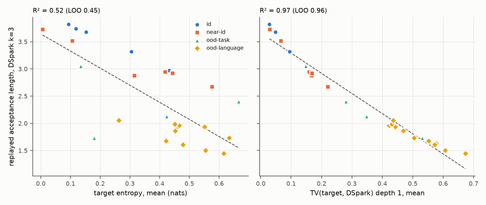
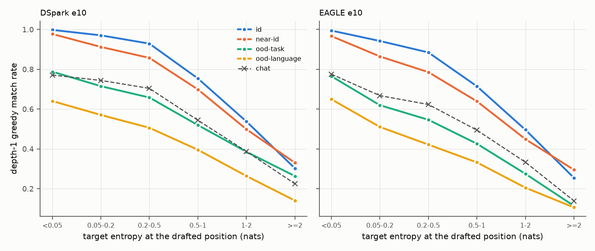
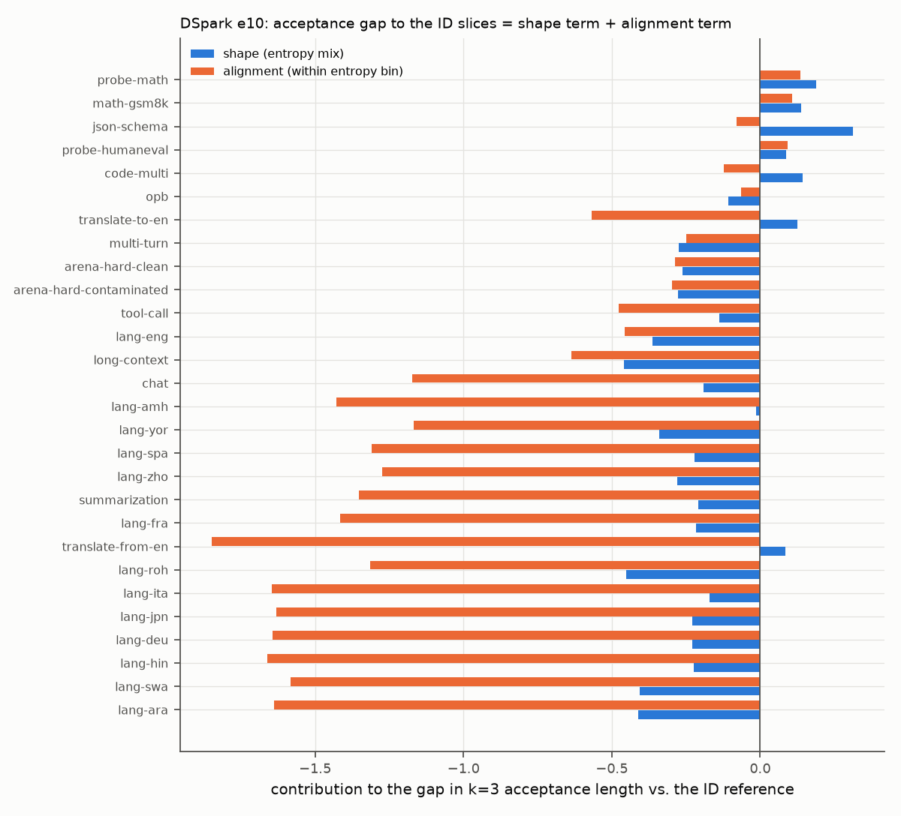
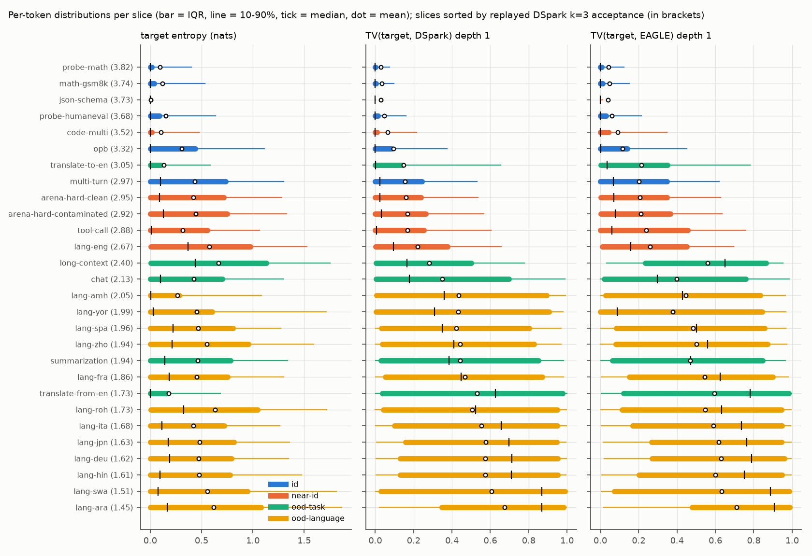

# Workload distribution shape: entropy, alignment and acceptance (Apertus 1.5 8B)

Action item D of the 2026-11-20 sync (Yu's hypothesis, transcript 9:14-14:36 and
31:40-34:42): acceptance differs by workload because the target's next-token
distribution is flatter (higher entropy) on chat than on math and code, and the
drafter is worse aligned there; whether a workload is in or out of distribution
should be judged by distribution shape, not by its label. No retraining: existing
target and drafters, inference only, per-workload distributions rather than
averages.

## Summary

**Verdict: the hypothesis is half right. A flat target lowers acceptance inside every
workload, but it does not explain the chat or non-English deficits. Those come
from poor drafter alignment where the target is confident.** The split between
"in" and "out of distribution" is a split in TV(target, drafter), not in target
entropy.

- **Replay validates.** Offline greedy replay of DSpark e10 at k=3 reproduces the
  served vLLM counters of the task-speed run on the same 896 prompts: Pearson
  r = 0.999 over 28 slices, mean absolute difference 0.022 tokens per step.
- **Entropy explains half, TV nearly all.** Across the 28 slices, mean target
  entropy explains R² = 0.52 of DSpark k=3 acceptance length (leave-one-out 0.45).
  Mean depth-1 TV(target, DSpark) explains 0.97 (LOO 0.96), and both together
  0.98. EAGLE gives 0.56 / 0.98 / 0.98, and the served counters give 0.53 / 0.97 /
  0.98. Over the 896 sequences: entropy 0.44, TV 0.93 (DSpark).
- **Chat is no flatter than the near-ID chat slices.** Chat's target entropy has
  median 0.10 nats and mean 0.42. Multi-turn (0.10 / 0.43) and Arena-Hard
  (0.09 / 0.42) are the same, yet they accept 2.92-2.97, while chat accepts 2.13.
  Chat's median depth-1 TV is 0.18, against 0.02-0.03 for those slices.
- **The non-English slices are not flatter either.** Their median target entropy
  is 0.004-0.33 nats, about the same as English chat or lower (Swahili 0.08, Hindi
  0.09, Amharic 0.004). Their median TV is 0.31-0.87. Translation out of English
  has a near-deterministic target (median 0.003 nats, the same as math) and
  still accepts only 1.73.
- **Low-entropy tokens in chat are not accepted like those in math.** Take
  positions where the target puts at least about 99% on one token (entropy
  < 0.05 nats). DSpark's top-1 matches there on 99.9% of math-gsm8k tokens,
  99.8% of OPB, 77% of chat, 73% of summarization and 51-75% of the 12
  non-English slices. Within each entropy bin, acceptance falls by class (figure
  below). Below 1 nat, the gap between the ID and OOD curves is larger than the
  effect of moving one bin to the right.
- **Decomposition.** Relative to the ID slices (opb, math, probes, multi-turn),
  the entropy-mix (shape) term explains 0.19 of chat's 1.36-token k=3 gap and
  the within-bin (alignment) term explains 1.17 (86%). For the languages,
  alignment explains 74-99% of a 1.4-2.1-token gap. Shape is a large part only
  for long-context (0.46 of 1.09), lang-eng (0.36 of 0.82) and the near-ID
  chat-like slices (about half of a 0.5-token gap). EAGLE gives the same picture.
- **Data-driven split.** Ran k-means on standardised (mean entropy, mean TV).
  k=2 (silhouette 0.53) gives a well-aligned group: opb, math-gsm8k, probe-math,
  probe-humaneval, multi-turn, code-multi, json-schema, tool-call, both
  Arena-Hard slices and translate-to-en (mean TV 0.10, acceptance 3.32). The
  poorly aligned group is chat, summarization, long-context, translate-from-en,
  lang-eng and all 12 languages (mean TV 0.48, acceptance 1.88). Mean entropy is
  0.23 nats in the first group and 0.48 in the second, and the two overlap: chat
  (0.42) and translate-from-en (0.18) sit inside the first group's entropy range. By this
  criterion translate-to-en, labelled OOD, is in distribution, since its output
  is English. k=4 (0.53) splits the first group into a low-entropy core
  (math, code, json, translate-to-en; 3.59) and a chat-like group (opb,
  multi-turn, tool-call, Arena-Hard, lang-eng, chat, long-context; 2.78), and
  puts chat with them on entropy. EAGLE gives the same clusters.
- **Caveat on "TV explains everything".** Greedy acceptance is the event "drafter
  top-1 = target top-1", so TV is close to a restatement of the outcome. The
  informative result is the negative one. The target-only quantity (entropy) does
  not separate the slices, and the drafter-dependent quantity (TV) does, even at
  tokens where the target is certain. The drafters have not learned these
  continuations. A flatter target is not the reason.

**What it means for the next experiments.** Better coverage of the target's
behaviour on chat, summarization and non-English text (data, or adaptation as in
the multilingual EAGLE run) addresses the measured gap. A recipe change aimed at
flat distributions (e.g. TV or entropy-aware objectives for high-entropy tokens)
can recover at most the shape term, about 0.2 tokens per step on chat. Judge ID vs
OOD by depth-1 TV on a small teacher-forced sample (here a few GPU-minutes per
slice), not by the task label.

## Results

The (entropy, TV) map for DSpark e10. Colour is the k=2 cluster and marker shape
is the label class. The EAGLE map is
[`shape-map-eagle.png`](../results/8b/workload-shape/full-20261122-4004306/figures/shape-map-eagle.png).

Depth-1 greedy match rate by the target's entropy at the drafted position, pooled
per label class, with chat dashed. Every class loses acceptance as entropy rises
(the shape effect within a workload). At equal entropy, the OOD classes stay far
below the ID class (the alignment effect between workloads).

Per-token distributions per slice: the bar is the IQR, the line spans 10-90%, the
tick is the median and the dot the mean. Target entropy is heavily skewed. Most
tokens of every slice sit near 0 nats, and the slices differ mainly in the upper
tail, so the median and the mean tell different stories. TV in the OOD slices is
bimodal: the IQR spans most of [0, 1].

### Per-slice statistics

Entropy in nats; TV and match at depth 1; acceptance length = tokens per step
(k=3, accepted drafts + 1). "served" is the vLLM counter of the controlled
task-speed run (DSpark e10 k=3, C=1).

| slice | class | target H median [IQR] | target top-1 median | DSpark TV d1 median [IQR] | DSpark match d1 | DSpark acc k3 replay / served | EAGLE TV d1 median [IQR] | EAGLE match d1 | EAGLE acc k3 |
|---|---|---|---|---|---|---|---|---|---|
| opb | id | 0.002 [0.000, 0.440] | 1.000 | 0.000 [0.000, 0.085] | 0.904 | 3.32 / 3.29 | 0.003 [0.000, 0.141] | 0.890 | 3.28 |
| math-gsm8k | id | 0.000 [0.000, 0.038] | 1.000 | 0.000 [0.000, 0.005] | 0.964 | 3.74 / 3.75 | 0.000 [0.000, 0.013] | 0.954 | 3.70 |
| probe-math | id | 0.000 [0.000, 0.016] | 1.000 | 0.000 [0.000, 0.002] | 0.974 | 3.82 / 3.82 | 0.000 [0.000, 0.007] | 0.962 | 3.75 |
| probe-humaneval | id | 0.000 [0.000, 0.090] | 1.000 | 0.000 [0.000, 0.013] | 0.956 | 3.68 / 3.71 | 0.000 [0.000, 0.031] | 0.944 | 3.61 |
| multi-turn | id | 0.102 [0.000, 0.734] | 0.983 | 0.024 [0.000, 0.243] | 0.844 | 2.97 / 2.95 | 0.068 [0.001, 0.347] | 0.817 | 2.90 |
| code-multi | near-id | 0.000 [0.000, 0.016] | 1.000 | 0.000 [0.000, 0.009] | 0.937 | 3.52 / 3.52 | 0.001 [0.000, 0.042] | 0.922 | 3.46 |
| json-schema | near-id | 0.000 [0.000, 0.000] | 1.000 | 0.000 [0.000, 0.000] | 0.970 | 3.73 / 3.73 | 0.000 [0.000, 0.000] | 0.965 | 3.69 |
| tool-call | near-id | 0.009 [0.000, 0.556] | 0.999 | 0.007 [0.000, 0.255] | 0.834 | 2.88 / 2.95 | 0.060 [0.000, 0.455] | 0.781 | 2.68 |
| lang-eng | near-id | 0.368 [0.005, 0.975] | 0.913 | 0.096 [0.002, 0.376] | 0.776 | 2.67 / 2.66 | 0.159 [0.010, 0.452] | 0.747 | 2.61 |
| arena-hard-clean | near-id | 0.091 [0.000, 0.719] | 0.984 | 0.025 [0.000, 0.239] | 0.843 | 2.95 / 2.95 | 0.072 [0.001, 0.348] | 0.809 | 2.86 |
| arena-hard-contaminated | near-id | 0.128 [0.000, 0.749] | 0.977 | 0.031 [0.000, 0.264] | 0.832 | 2.92 / 2.92 | 0.079 [0.002, 0.366] | 0.801 | 2.84 |
| chat | ood-task | 0.098 [0.000, 0.702] | 0.984 | 0.178 [0.003, 0.697] | 0.656 | 2.13 / 2.07 | 0.299 [0.019, 0.759] | 0.624 | 2.09 |
| summarization | ood-task | 0.142 [0.000, 0.781] | 0.974 | 0.385 [0.030, 0.850] | 0.577 | 1.94 / 1.95 | 0.470 [0.063, 0.846] | 0.570 | 1.97 |
| long-context | ood-task | 0.439 [0.007, 1.131] | 0.892 | 0.165 [0.005, 0.501] | 0.716 | 2.40 / 2.44 | 0.649 [0.234, 0.864] | 0.523 | 1.75 |
| translate-to-en | ood-task | 0.001 [0.000, 0.104] | 1.000 | 0.002 [0.000, 0.144] | 0.861 | 3.05 / 3.08 | 0.035 [0.002, 0.350] | 0.814 | 2.77 |
| translate-from-en | ood-task | 0.003 [0.000, 0.178] | 1.000 | 0.626 [0.036, 0.977] | 0.504 | 1.73 / 1.74 | 0.781 [0.122, 0.982] | 0.443 | 1.62 |
| lang-deu | ood-language | 0.188 [0.001, 0.791] | 0.963 | 0.711 [0.130, 0.952] | 0.444 | 1.62 / 1.61 | 0.790 [0.269, 0.959] | 0.406 | 1.58 |
| lang-fra | ood-language | 0.185 [0.001, 0.756] | 0.962 | 0.449 [0.052, 0.871] | 0.551 | 1.86 / 1.84 | 0.624 [0.152, 0.900] | 0.490 | 1.76 |
| lang-ita | ood-language | 0.112 [0.000, 0.720] | 0.980 | 0.657 [0.100, 0.950] | 0.473 | 1.68 / 1.66 | 0.737 [0.168, 0.947] | 0.441 | 1.63 |
| lang-spa | ood-language | 0.221 [0.001, 0.805] | 0.953 | 0.350 [0.032, 0.804] | 0.592 | 1.96 / 1.98 | 0.502 [0.082, 0.856] | 0.535 | 1.86 |
| lang-roh | ood-language | 0.327 [0.006, 1.045] | 0.929 | 0.524 [0.041, 0.950] | 0.509 | 1.73 / 1.76 | 0.631 [0.114, 0.946] | 0.482 | 1.68 |
| lang-zho | ood-language | 0.213 [0.001, 0.958] | 0.958 | 0.410 [0.036, 0.828] | 0.575 | 1.94 / 1.93 | 0.558 [0.080, 0.873] | 0.523 | 1.85 |
| lang-jpn | ood-language | 0.175 [0.001, 0.817] | 0.966 | 0.697 [0.159, 0.946] | 0.452 | 1.63 / 1.64 | 0.763 [0.267, 0.945] | 0.418 | 1.59 |
| lang-hin | ood-language | 0.094 [0.000, 0.779] | 0.984 | 0.709 [0.130, 0.952] | 0.453 | 1.61 / 1.63 | 0.751 [0.201, 0.947] | 0.428 | 1.59 |
| lang-ara | ood-language | 0.165 [0.001, 1.080] | 0.970 | 0.868 [0.348, 0.982] | 0.362 | 1.45 / 1.44 | 0.908 [0.478, 0.987] | 0.306 | 1.37 |
| lang-swa | ood-language | 0.076 [0.001, 0.947] | 0.990 | 0.870 [0.030, 0.990] | 0.409 | 1.51 / 1.47 | 0.887 [0.072, 0.986] | 0.394 | 1.49 |
| lang-yor | ood-language | 0.030 [0.000, 0.602] | 0.996 | 0.308 [0.005, 0.906] | 0.566 | 1.99 / 2.00 | 0.089 [0.001, 0.844] | 0.648 | 2.10 |
| lang-amh | ood-language | 0.004 [0.000, 0.283] | 1.000 | 0.359 [0.005, 0.894] | 0.574 | 2.05 / 2.13 | 0.427 [0.027, 0.833] | 0.582 | 2.02 |

Further numbers in [`analysis.json`](../results/8b/workload-shape/full-20261122-4004306/analysis.json):

- R² per metric, k=3 and k=7, slice and sequence level, with leave-one-out values.
- The decomposition per slice for both drafters, for the depth-1 match rate and
  the k=3 step acceptance.
- Per-bin rates for each class and for selected slices.
- Clusters for k=2..4.
- Per-depth match curves and per-sequence acceptance quantiles, in
  [`aggregate.json`](../results/8b/workload-shape/full-20261122-4004306/aggregate.json).

### Other observations

- **Variance within a slice is large.** Per-sequence DSpark k=3 acceptance in
  chat ranges from 1.22 (10th percentile) through 2.59 (median) to 3.06 (90th
  percentile); OPB from 2.62 to 3.97. Math-gsm8k is tight (3.57-3.85) and so is
  lang-deu (1.49-1.93). Six of the 32 chat prompts are mostly non-ASCII. They
  average 2.05, against 2.41 for the rest
  ([`chat-script-check.json`](../results/8b/workload-shape/full-20261122-4004306/chat-script-check.json), a rough script proxy
  computed on the cluster). Even the English-script chat sequences stay well below
  Arena-Hard (2.98) at lower entropy (0.38 vs 0.43 nats), so hidden non-English
  turns do not explain chat's deficit.
- **EAGLE degrades on long context.** On long-context, EAGLE's median TV is 0.65,
  against 0.17 for DSpark, and its k=3 acceptance is 1.75 against 2.40. Prompts
  there are 8.5k-24k tokens, longer than the 8,192-token training sequences of
  both heads. EAGLE falls further, so this gap between the drafters reflects
  context length, not the output distribution.
- **Per-depth decay.** DSpark's match rate decays with depth (chat: 0.66 at depth
  1, 0.37 at depth 7), whereas EAGLE's stays flat after depth 1 (0.62 to 0.53).
  This matches EAGLE's full conditioning on drafted tokens against DSpark's
  one-token Markov head.
- **HF/vLLM agreement.** The HF target's argmax equals the vLLM greedy token on
  98.5-99.9% of positions per slice (worst lang-ara). The remaining mismatch puts
  a floor of about 1% under the match rates, uniformly across slices.

### Caveats

- One greedy trajectory per prompt, capped at 512 tokens, thinking off, and 32
  prompts per slice. Slice-level R² rests on 28 points that are not independent
  (12 languages from one source). The sequence-level fits (896 points) agree.
- Greedy acceptance only. With sampling, acceptance per token is 1 − TV, so the
  sampled case is directly the TV column. It was not replayed.
- The served comparison uses the pilot's chat template and per-source caps (OPB up
  to 1,024 tokens). The two agree within 0.08 tokens on every slice regardless.
- The ID reference of the decomposition is fixed by the suite's labels (opb,
  math-gsm8k, probe-math, probe-humaneval, multi-turn). Bins are 6 fixed entropy
  intervals, so residual shape differences within a bin count as alignment.

## Reproducibility

- Run: Clariden job 4004306 (node nid007327, account d_research_serving, normal,
  13 min on 4 GH200). Earlier smoke jobs: 4004211 failed at engine start on a
  FlashInfer lock under the over-quota home; 4004241 passed with 2 prompts per
  shard. Compute was 1.65 GPU-hours in total.
- Code: branch `experiment/workload-distribution-shape`, source commit
  `f87ab168` (`git archive` copy on the cluster, `SOURCE_REVISION`; tarball
  sha256 `b802877408a0f796...`).
- Image: `vllm_apertus_1.5_release-arm64.sqsh`, sha256 `f5fc017f...`.
- Target: Apertus-v1.5-8B, revision `a411d838`.
- DSpark e10: thinking-off, epoch-10 final on capstor, sha256 `002d1167...`.
- EAGLE e10: best checkpoint 251,955, sha256 `42b05496...`. Its scratch copy was
  purged, so it was restored from the private HF repo
  `faruk-zahiragic/Apertus-v1.5-8B-EAGLE3.1-e10-thinking-off` (revision
  `4c9d4c9e`), and the hash matches the tree screen's.
- Corpus: `7d8e60ef...` and coverage `ddb921fe...`, both rebuilt and matching the
  frozen digests.
- [`full-20261122-4004306/`](../results/8b/workload-shape/full-20261122-4004306) holds the aggregates, sequence table, analysis,
  figures, shard summaries, capture metadata (token ids removed), the sbatch file,
  the environment, the pytest log and
  [`cluster-only-sha256.txt`](../results/8b/workload-shape/full-20261122-4004306/cluster-only-sha256.txt). The last file holds the
  hashes of the captures, the per-token npz shards and the corpus, which stay on
  Clariden under `/iopsstor/scratch/cscs/faruk_zahiragic/workload-shape/runs/full-20261122/`
  (restricted prompts; scratch is purgeable).
- Re-run: `experiments/workload-shape/submit-shape.sh RUN_DIR` on the cluster
  (with `SML_ENV_DIR` on scratch while home is over quota), then
  `analyze.py RUN_DIR`.

## Method

**Prompts.** The 28 slices of the per-task speed suite
([`inputs/suite.yaml`](../results/8b/workload-shape/inputs/suite.yaml)), 32 prompts
each, 896 in all: the exact corpus of the controlled task-speed run (digest
`7d8e60ef...`). The corpus and its coverage source were purged from Clariden
scratch on 2026-11-20; [`build_corpus.py`](../experiments/workload-shape/build_corpus.py)
rebuilt both from the pinned sources
([`fetch_coverage_raw.py`](../experiments/workload-shape/fetch_coverage_raw.py),
`apertus_bench.coverage_workloads` from the workload-coverage branch) and the run
refuses to continue unless every slice selects the frozen ids and the corpus, the
coverage file (`ddb921fe...`) and every source file match their frozen digests.
They all matched.

**Trajectories.** Plain vLLM greedy continuations of the Apertus-v1.5-8B target
(`apertus_eagle.verify_offline capture --mode plain`, thinking off, C=1, 512-token
cap, model's own chat template), one corpus shard per GPU. The served task-speed
run used the pilot's chat template and per-source caps (OPB up to 1,024 tokens);
this study caps everything at 512.

**Distributions** ([`apertus_tree.shape`](../methods/tree/apertus_tree/shape.py)).
Each sequence (prompt + continuation) runs once through the HF target with teacher
forcing; DSpark e10 and EAGLE e10 run on the same hidden states with the model code
of the tree-drafter screen (`apertus_tree.candidates`), which reproduced served
acceptance there. For every decode step with anchor `a` (the newest token, which
the target emitted last) and depth `d = 1..7` (the d-th drafted token, which
predicts position `a + d`):

- target distribution `p` at `a + d`: what the verifier compares the drafted token
  against;
- drafter distribution `q`, teacher-forced: the drafter's distribution for
  `a + d` given that tokens `a+1 .. a+d-1` were drafted correctly, the only case in
  which depth `d` is reached.
  - **DSpark** drafts a block in one forward (slot 0 = anchor token, slots 1..7 =
    mask). Slot `d-1` gives base logits for `a + d`, and the vanilla Markov head adds
    `W2 W1[token a+d-1]`. The base logits do not depend on the drafted tokens, so
    teacher forcing only fixes the Markov bias: the depth-`d` distribution is that of
    the deployed chain whenever depth `d` is reached. Depth 1 has the same
    conditioning as EAGLE's depth 1; deeper DSpark slots see no drafted token except
    the previous one through the Markov head, while EAGLE's deeper steps see all of
    them.
  - **EAGLE** depth 1 reads the target's hidden state at `a-1` and token `a`; depth
    `d > 1` feeds the true token `a+d-1` and its own previous hidden state (TTT
    layout).
- per (a, d): target entropy and top-1 probability; drafter entropy, top-1
  probability, TV(p, q) = ½Σ|p−q|, KL(p‖q), whether the drafter's top-1 equals the
  trajectory token (the greedy acceptance test) and the target's top-1.

**Realised acceptance** is replayed from the greedy match arrays
([`shape_aggregate.py`](../methods/tree/apertus_tree/shape_aggregate.py)): a chain
starts at the first generated token, accepts the leading run of matching depths up
to k and jumps by accepted + 1 (acceptance length per step = accepted + 1, as vLLM
counts it), for k = 1, 3, 5, 7. It is checked against the served DSpark k=3
counters of the task-speed run on the same prompts.

**Analysis** ([`analyze.py`](../experiments/workload-shape/analyze.py)): per-slice
quantiles; R² (and leave-one-out R²) of acceptance on each metric across the 28
slices and across the 896 sequences; a decomposition of each slice's gap to the ID
reference (opb, math-gsm8k, probe-math, probe-humaneval, multi-turn) into a shape
term `Σ_b (s_w(b) − s_ref(b))·a_ref(b)` (a different mix of entropy bins `b`, at the
reference's per-bin acceptance) and an alignment term `Σ_b s_w(b)·(a_w(b) − a_ref(b))`
(different acceptance within the same entropy bin), for the depth-1 match rate and
for the k=3 step acceptance length binned by the entropy of the step's first drafted
position; k-means clusters (k = 2..4, silhouette) on standardised (mean target
entropy, mean depth-1 TV).
