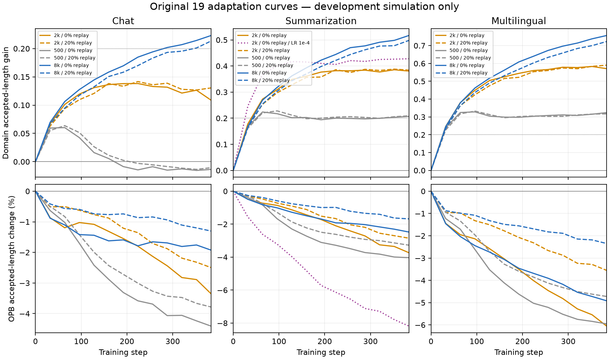

# T5 bounded adaptation recovery

All 19 original curves completed. Multilingual and summarization heads completed serving confirmation with specialist gains. The overall campaign remains in progress: final chat confirmation is running.

The original deterministic development-only rule selected the final 8k/no-replay head per domain. No held-out serving result entered selection. The simulated acceptance metric measures trainer rollouts, not served output tokens per target forward pass.

| Original arm | Final development gain | OPB change | Reported training wall (min) |
| --- | ---: | ---: | ---: |
| adapt-chat-n2k-r0 | +0.1087 | -3.35% | 19.28 |
| adapt-chat-n2k-r20 | +0.1305 | -2.50% | 17.85 |
| adapt-chat-n500-r0 | -0.0137 | -4.41% | 18.73 |
| adapt-chat-n500-r20 | -0.0106 | -3.79% | 18.08 |
| adapt-chat-n8k-r0 | +0.2231 | -1.93% | 19.22 |
| adapt-chat-n8k-r20 | +0.2134 | -1.30% | 18.29 |
| adapt-mult-n2k-r0 | +0.5708 | -6.05% | 17.49 |
| adapt-mult-n2k-r20 | +0.5904 | -3.55% | 20.24 |
| adapt-mult-n500-r0 | +0.3244 | -5.95% | 23.08 |
| adapt-mult-n500-r20 | +0.3175 | -4.72% | 31.21 |
| adapt-mult-n8k-r0 | +0.7568 | -4.92% | 29.71 |
| adapt-mult-n8k-r20 | +0.7232 | -2.35% | 35.18 |
| adapt-summ-n2k-r0 | +0.3806 | -3.73% | 38.40 |
| adapt-summ-n2k-r0-lr1e4 | +0.4278 | -8.19% | 38.93 |
| adapt-summ-n2k-r20 | +0.3841 | -2.85% | 38.04 |
| adapt-summ-n500-r0 | +0.2070 | -4.03% | 42.42 |
| adapt-summ-n500-r20 | +0.2091 | -3.27% | 38.11 |
| adapt-summ-n8k-r0 | +0.5169 | -2.48% | 40.82 |
| adapt-summ-n8k-r20 | +0.4979 | -1.68% | 38.61 |

[Full development evaluations](development-curves-derived.json) retain all points. Only final heads were eligible for serving selection; intermediate evaluations are descriptive. All original training scientific gates are retained. The 500-trace chat arms finish below initial development acceptance even though their original best-evaluation improvement gate passes. Replay generally reduces forgetting; it was not used to filter specialist selection.

The preregistered serving review requires at least 10% throughput and 10% median decode-latency improvement in both GPU-swapped repeats, calibrated correctness, and successful measured requests/warmups. Every original held-out prompt pass, k3/k7, and C1/64/256 remains included. TTFT/tail/OPB regressions restrict recommendations to explicit conditional tradeoffs. Full trace and domain-training allocations enter conservative break-even cost; no monetary tariff is assumed.

Training as-run source: `589ddd593f62255f9217c1b40e5502808cc7bb94`. Current repaired serving source: `7f0a41dcc0a3c5d433b83dac80075ee0516a694e`, frozen separately. Original policy SHA256: `64c9844f6cd526e6c693f85a5f75cc0d5d7d3f605112b14c3ae1c70a969ef44c`.

The [lossless training capsule](training-curves-complete-20261031b.tgz) contains 208 configurations, summaries, histories, export reports, source manifests, launch/image/target provenance and compressed raw training logs. SHA256 `f8504b3dae900caea63474dd027d591b292dd8e1cc94109742ea9c86a1e43f24`; each member is verified against [its collection manifest](collection-manifest.json). Checkpoints and restricted prompt corpora remain on the cluster.

Earlier failed attempts are preserved. [Serving startup failure3814329](failed-confirmation-3814329.json) has a [46-file raw capsule](failed-confirmation-3814329.tgz): inherited long scratch TMPDIR caused vLLM AF_UNIX socket paths over107bytes before any requests. The fresh repair uses short job/round/arm runtime TMPDIR and explicit VLLM_RPC_BASE_PATH; all four on-node socket bind probes passed at96/97bytes. Failed allocation cost remains included.

Multilingual job 3814370 completed in 4,264 s. All 40 calibrated correctness gates passed; all six primary k3/k7 × C1/64/256 cells satisfy the original matched-k benefit rule. At k3/C1, throughput is 267→312–313 tok/s, median decode time 3.41→2.78–2.79 ms/token. At k7/C1, matched throughput improves 26–30%, 254–259→325–329 tok/s; decode time falls 3.49–3.55→2.38–2.41 ms/token. OPB regressions and high-concurrency TTFT tradeoffs prevent broad replacement.

The [full paired summary](multilingual-confirmation-summary.json) retains every absolute cell metric. The [configuration review](multilingual-configuration-review.json) adds a descriptive comparison to stronger already measured unadapted k settings: at C64/256, unadapted k3 outperforms adapted k7. These supplementary cross-k comparisons use separate GPU pairs; the original matched-k verdicts remain unchanged. The recovery cost of all traces plus all multilingual curves is 15.77 GPUh; the selected head's training-loop lower bound is 1.98 GPUh. At C1, observed savings versus the stronger unadapted k3 baseline amortize those recovery costs after about 80–85M output tokens with adapted k7, or 104M with matched k3. Selected training alone gives much smaller lower bounds. These are one-time experimental recovery costs, not a measured recurring production-update cost.

The [raw capsule manifest](confirmation-3814370-capsule/capsule-manifest.json) links 25 MiB binary parts of the byte-identical complete archive (SHA256 `b8ec1db68d6f4af4b7043a3e787329838ed733ac35d1dde875ae5701bba3a5ad`). It contains 1,785 raw measurement, capture, metric-snapshot and provenance files. The [integrity audit](confirmation-3814370-capsule/integrity-audit.json) verifies all member hashes, 240 complete cells and all 108,544 successful measured requests, zero failed warmups, exact corpus hashes, full prompt passes and required EAGLE provenance. Reproduce with `python3 verify-capsule.py confirmation-3814370-capsule`.

Summarization job 3814755 completed in 1,926 s with all eight correctness gates passing. Only C1 satisfies the full serving-benefit rule. The competitive k3 setting improves 221→251 tok/s, 4.13→3.55 ms/token, and p95 request latency 1.58→1.414 s. Higher-load improvements do not qualify. Adapted k3 also outperforms adapted k7, whose larger matched-k gain uses a weaker baseline. Selected-head training is 2.72 GPUh; all traces plus all summarization curves cost 23.93 GPUh (about 160M output tokens to amortize at k3/C1), a recovery/search cost rather than a measured recurring production-update cost.

The [summarization paired summary](summarization-confirmation-summary.json), [complete raw capsule](confirmation-3814755-capsule/capsule-manifest.json), and [integrity audit](confirmation-3814755-capsule/integrity-audit.json) retain all 48 cells, 22,528 successful measured requests, zero failed warmups and exact source/corpus/target/checkpoint identities. The archive contains 410 files and its exact scheduling-only override, SHA256 `85088ac5ec4a886d533cc472fc66aee36af24f9212940abcbad7c8a5fb86ce08`.

Remote complete artifact root: `/iopsstor/scratch/cscs/faruk_zahiragic/spec-exp-data/drafter-updates/recovery-20261030-cache`. Machine status: `receipts/campaign.json`. Final chat job 3815183 is running on nid006274; its original 12 h request was already allocated and was retained. The controller sequences only the original selected heads and closes with `verdict.json`/`verdict.md`.

Scope: original bounded EAGLE adaptation only. This does not conclude broad action#10/A3, implement routing, deploy a head, or establish any DSpark adaptation result. A strong qualifying EAGLE serving result only records the original conditional DSpark best-setting follow-up, dependent on a verified compatible port/data/provenance.
